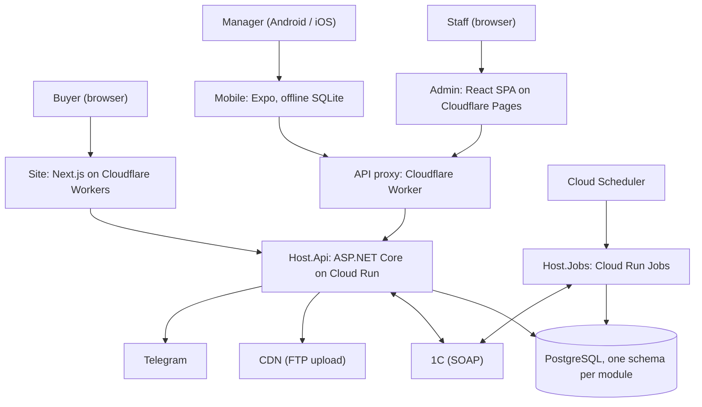
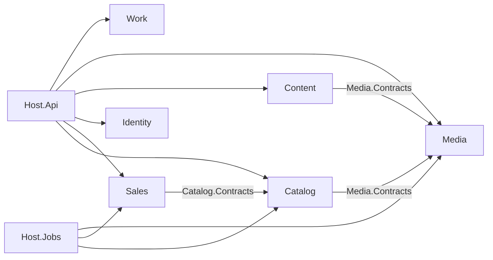

# Kedr: B2B commerce platform on top of 1C

Kedr is a door hardware company in Kharkiv, Ukraine. It sells wholesale to about a hundred active trade customers and takes retail orders too. Products, prices, stock, customers and orders live in **1C**, the accounting system.

This project is the platform built around 1C:

- **Public catalog site** [classkedr.com.ua](https://classkedr.com.ua) in Ukrainian and Russian, built for search engines, with a quick order form.
- **Admin app** for the staff (managers, executives, an SEO specialist): catalog and product attributes, site content, the CDN media library, customers, orders at customer prices, staff tasks and access.
- **«Kedr Manager» mobile app** for sales managers on the road: works offline for up to 7 days, shows big product photos and technical schemes, calculates an order at the customer's prices and sends it to 1C.
- **API** that syncs with 1C and serves all three clients.

The whole system was designed and built by one developer: backend, web, mobile, CI/CD and cloud setup. AI coding assistants (Claude Code, Codex) were used for coding, reviews and documentation.

## Key features

| Area | What it does |
| --- | --- |
| 1C sync | Scheduled jobs import categories, products, prices for every price type, stock and customers over SOAP; manager orders go back to 1C with retry, 1C document numbers and Telegram alerts |
| Catalog | Recognises colour, size and type from 1C product names, groups variants into «models», shows them on the site with filters and stable SEO URLs |
| Customer prices | Server-side quote per customer: price type by category rules, per-line discounts and markups, minimum price checks, saved drafts |
| Offline mobile | Full catalog and customer snapshots (`ETag`/`304`, gzip) in SQLite, send queue with idempotency keys, quick unlock |
| Site | Server-rendered Next.js on Cloudflare Workers, tag-based cache in KV, on-demand refresh from the admin, sitemaps, structured data, hreflang |
| Content | Articles, contacts, requisites, legal documents with versions, gallery, page SEO texts, analytics codes, all edited in the admin |
| Media | CDN picture library with folders, FTP upload, a sync job that links CDN files to products |
| Access | Cookie session + CSRF for browsers, bearer + refresh tokens for mobile, roles and policies, staff activity log |

## Tech stack

| Part | Stack |
| --- | --- |
| Backend | .NET 10, ASP.NET Core, EF Core 10 + PostgreSQL, ASP.NET Core Identity, Mediator (CQRS), FluentValidation, Ardalis.Result/Specification, Serilog, WCF SOAP client for 1C |
| Tests (backend) | xUnit: unit, integration on real PostgreSQL (Testcontainers), architecture tests for module boundaries |
| Admin | React 19, Vite, MUI 9, Redux Toolkit / RTK Query, React Hook Form, Vitest, Playwright |
| Site | Next.js 16 App Router, React 19, shadcn/ui (Radix), Tailwind CSS v4, OpenNext for Cloudflare |
| Mobile | Expo 58, React Native, Expo Router, expo-sqlite + Drizzle, TanStack Query, Zustand, EAS Build |
| Monorepo | Nx (176 projects), OpenAPI snapshot → generated TypeScript types |
| Cloud | Google Cloud Run (API) and Cloud Run Jobs + Cloud Scheduler (sync jobs), Artifact Registry, Secret Manager, Workload Identity Federation; Cloudflare Workers (site, API proxy), Cloudflare Pages (admin), Cloudflare KV; managed PostgreSQL |
| CI/CD | GitHub Actions: tests → images → migration job → deploy; Nx affected checks for the frontends |

## Architecture



The backend is a **modular monolith**. Six business modules (Catalog, Sales, Identity, Content, Media, Work) each have four layers (Api, Application, Domain, Infrastructure), their own PostgreSQL schema and their own migration history. Modules talk only through small `*.Contracts` projects; architecture tests fail the build if a module reaches into another one.



Key decisions:

- [Modular monolith with one PostgreSQL schema per module](docs/sdd/architecture/decisions/0001-modular-monolith.md)
- [1C sync and migrations as one-shot jobs on Cloud Run Jobs](docs/sdd/architecture/decisions/0002-one-shot-jobs-on-cloud-run.md)
- [Cloudflare Worker as the API front door](docs/sdd/architecture/decisions/0003-cloudflare-worker-api-front-door.md)
- [Next.js on Cloudflare Workers for the public site](https://github.com/Weretik/kedr-web/blob/main/docs/architecture/site/adr/0001-nextjs-public-site.md)
- [Offline-first mobile app](https://github.com/Weretik/kedr-web/blob/main/docs/architecture/mobile/adr/0005-offline-first-local-database.md)

More: [architecture](docs/sdd/architecture/README.md), [feature map](docs/sdd/features/README.md), [operations](docs/sdd/operations/README.md). Frontends: [kedr-web](https://github.com/Weretik/kedr-web).

## Repository layout

```text
KedrStore/                     backend (.NET), this repository
  src/Bootstrapper/Host.Api    HTTP API host
  src/Bootstrapper/Host.Jobs   one-shot job runner: --job=migrate, --job=full, --job=sync-one-c-orders, ...
  src/Modules/<Module>/<Module>.{Api,Application,Contracts,Domain,Infrastructure}
  src/BuildingBlocks/*         shared primitives, Mediator pipeline, 1C SOAP transport
  tests/{UnitTests,IntegrationTests,ArchitectureTests}
  deploy/cloudflare/api-proxy  API proxy Worker
kedr-web/                      frontends (Nx), https://github.com/Weretik/kedr-web
  apps/{admin,site,mobile}     applications
  libs/{admin,site,mobile,shared}/<domain>/{feature,ui,data-access,model}
```

## Run locally

### Backend

Requirements: .NET SDK 10 (see `global.json`), PostgreSQL (tests use 18).

1. Create a database and a user.
2. Put local settings into User Secrets (never into `appsettings*.json`):

   ```powershell
   cd KedrStore
   dotnet user-secrets set "ConnectionStrings:Default" "Host=localhost;Port=5432;Database=kedr;Username=kedr;Password=<local-password>" --project src/Bootstrapper/Host.Api/Host.Api.csproj
   dotnet user-secrets set "ConnectionStrings:Default" "Host=localhost;Port=5432;Database=kedr;Username=kedr;Password=<local-password>" --project src/Bootstrapper/Host.Jobs/Host.Jobs/Host.Jobs.csproj
   dotnet user-secrets set "ADMIN_DEFAULT_PASSWORD" "<first-admin-password>" --project src/Bootstrapper/Host.Jobs/Host.Jobs/Host.Jobs.csproj
   ```

3. Create the schema and the first administrator. The API never migrates at startup:

   ```powershell
   dotnet run --project src/Bootstrapper/Host.Jobs/Host.Jobs/Host.Jobs.csproj -- --job=migrate
   ```

4. Start the API on `https://localhost:7230` (Swagger and `/health` are available):

   ```powershell
   dotnet run --project src/Bootstrapper/Host.Api/Host.Api.csproj --launch-profile https
   ```

Optional integrations stay off until you configure them:

| Setting | Example value | Without it |
| --- | --- | --- |
| `OneCSoap:Endpoint`, `Username`, `Password` | `https://onec.example.invalid/base/ws/ws1.1cws` | 1C jobs and order sending fail with a clear error |
| `Telegram:BotToken`, `ChatId` | `<bot-token>`, `<chat-id>` | no Telegram alerts |
| `MediaStorage:Ftp:Password` | `<ftp-password>` | uploads answer 503 |
| `SiteRevalidation:Url`, `Secret` | `http://localhost:3000`, `<shared-secret>` | «Refresh site now» answers 503 |
| `TrustedProxy:SharedSecret` | `<shared-secret>` | client IP is taken from the connection |

Tests: `dotnet test tests/UnitTests/UnitTests.csproj` (fast), `tests/ArchitectureTests`, `tests/IntegrationTests` (needs Docker).

### Frontends

Requirements: Node 24 (`>=24.18 <25`), npm 11.

```bash
cd kedr-web
npm ci
npx nx serve admin      # admin at http://localhost:4200, API from apps/admin/.env.development
npx nx dev site         # site, set KEDR_API_URL
npx nx start mobile     # Expo dev server; needs a development build, not Expo Go
```

Example `apps/site/.env.local` (git-ignored):

```dotenv
KEDR_API_URL=https://localhost:7230
# SITE_ENV=production and SITE_INDEXING=true only in production; otherwise every page is noindex
KEDR_REVALIDATE_SECRET=<shared-secret>
```

Example `apps/mobile/.env.local`:

```dotenv
EXPO_PUBLIC_API_BASE_URL=https://api.example.com
```

Checks: `npx nx run <project>:vite:test -- --run`, `npx nx run <project>:lint`, `npm run test:site`, `npm run contracts:check`.

## Deployment

- **Backend:** push to `master` → GitHub Actions runs unit, architecture and integration tests → builds `api` and `host-jobs` images → runs the migration job → deploys Cloud Run → updates Cloud Run Jobs. Google Cloud access uses Workload Identity Federation (no keys in GitHub); all secrets come from Secret Manager.
- **Site:** Cloudflare Workers Builds (`nx run site:build-cloudflare`, `site:deploy-cloudflare`).
- **Admin:** Cloudflare Pages.
- **Mobile:** EAS Build profiles `development`, `preview`, `production`.

## Status

In production: the new site has served classkedr.com.ua since November 2026, and the staff have used the admin and the API every day for about two months. The mobile app was tested on real phones by the sales managers and is not yet published to the stores.

## License

This project is licensed under the PolyForm Noncommercial License 1.0.0. Commercial use is not permitted. See [LICENSE.txt](LICENSE.txt).
