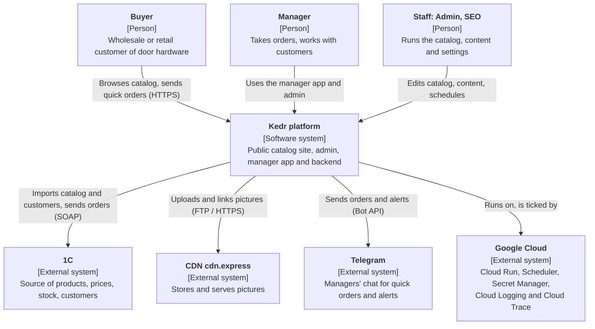
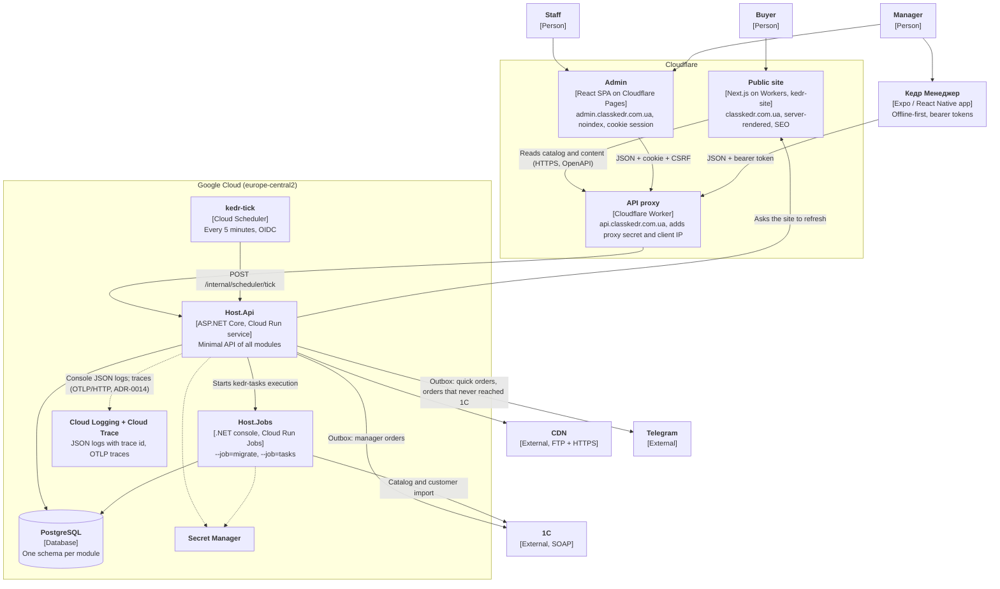
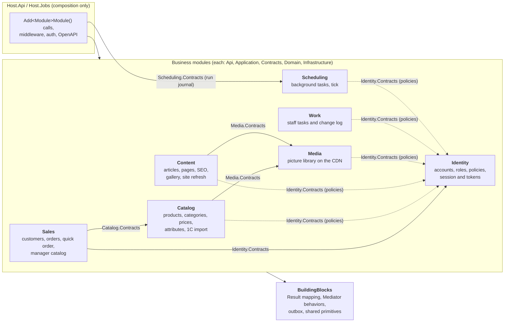

# C4 diagrams

**Checked against code:** 2026-11-16 (`src/`, `.github/workflows/deploy-cloudrun.yml`, project references, kedr-web `apps/`).

Three levels of the [C4 model](https://c4model.com): who uses the system and what it talks to (context), which deployable parts it has (containers), and what is inside the API (components). The diagrams are Mermaid and render on GitHub. Why each part looks the way it does is in the [ADRs](../decisions/README.md).

Update a diagram in the same change that adds or removes a module, a host, a deployable app, an external system, or a connection between them.

## Level 1: System context

## Level 2: Containers

The old Angular storefront (Cloudflare Pages project `kedr-web`) still serves pages until the domain cutover; it is not drawn.

## Level 3: Components of the backend

Solid arrows: a module reads or calls another through its `Contracts`. Dotted: only policy and role names. No module references another module's Application, Domain or Infrastructure; architecture tests enforce it ([ADR-0004](../decisions/0004-contracts-and-business-folders.md)).

Inside a module the code follows the [use-case flow](../runtime/use-case-flow.md): endpoint → command or query → Mediator pipeline → handler → aggregate → `DbContext` of the module's schema.
