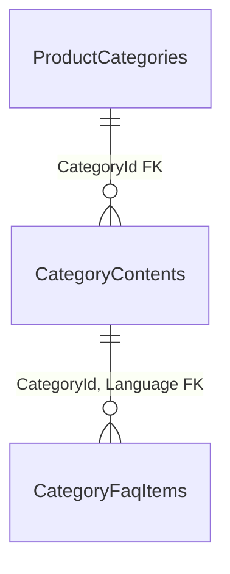

# Catalog — categories: data

**Source:** [Catalog snapshot](../../../../src/Catalog/Catalog.Infrastructure/Migrations/CatalogDbContextModelSnapshot.cs) and [ProductCategoryConfiguration](../../../../src/Catalog/Catalog.Infrastructure/Configurations/ProductCategoryConfiguration.cs), checked 2026-10-30. [Back to database map](README.md) · [categories feature](../../features/catalog/categories.md).

`ProductCategories` (PK `Id`) stores the category tree: `ParentId`, `Path`, `Level`, `Slug`, `Name`, `ShortNameUk`, `ShortNameRu`, `SortOrder`, and `ProductTypeIdOneC`. `ParentId` represents the parent category, but the snapshot has no physical self-referencing FK. `Products.CategoryId` has an FK to `ProductCategories.Id`; see [product data](catalog-products.md) for that relationship.

Since [stable URLs](../../specs/catalog/005-stable-urls-and-category-content/README.md): `ProductCategories` also has `IsDeleted`, `DeletedAt`, `UpdatedAt` (a global query filter hides deleted rows) and a unique index on `Slug`.

| Table | Key | Purpose |
| --- | --- | --- |
| `CategoryContents` | (`CategoryId`, `Language`) | Admin-written `SeoTitle`, `MetaDescription`, `H1`, sanitized `BodyHtml`, `UpdatedAt`, `UpdatedBy`; FK to `ProductCategories` (restrict). |
| `CategoryFaqItems` | `Id` (identity) | `SortOrder`, `Question`, `Answer`; FK (`CategoryId`, `Language`) to `CategoryContents` (cascade). |
| `CatalogSlugHistory` | (`EntityType`, `Slug`) | Former slug of a product (`1`) or category (`2`) and its `EntityId`; no FK, so history survives soft deletes. |

