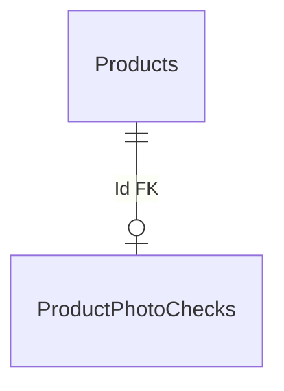

# Catalog — photo-check data

**Sources:** [Catalog snapshot](../../../../src/Catalog/Catalog.Infrastructure/Migrations/CatalogDbContextModelSnapshot.cs) and [ProductPhotoCheckConfiguration](../../../../src/Catalog/Catalog.Infrastructure/Configurations/ProductPhotoCheckConfiguration.cs), checked 2026-10-21. [Back to the database map](README.md) · [photo-check feature](../../features/catalog/photo-check.md).

`ProductPhotoChecks` has primary key `Id`, which is also a foreign key to `Products.Id`. The table stores `PhotoUrl`, `Status`, `CheckedAtUtc`, `HttpStatusCode`, `DiagnosticCode`, and `DiagnosticMessage` — the result of checking a product photo.

The main `Products` table is described in [product data](catalog-products.md).
