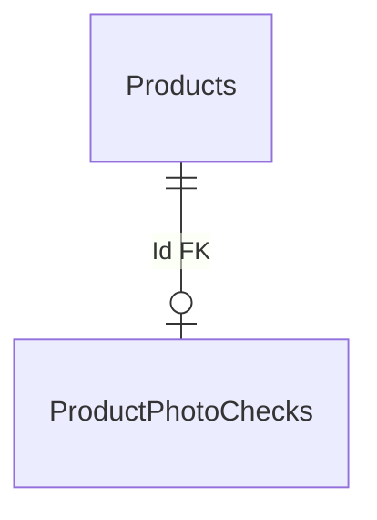

# Catalog — перевірка фото: дані

**Джерело:** [Catalog snapshot](../../../../src/Catalog/Catalog.Infrastructure/Migrations/CatalogDbContextModelSnapshot.cs) і [ProductPhotoCheckConfiguration](../../../../src/Catalog/Catalog.Infrastructure/Configurations/ProductPhotoCheckConfiguration.cs), перевірено 2026-10-21. [Назад до карти БД](README.md) · [фіча перевірки фото](../../features/catalog/photo-check.md).

`ProductPhotoChecks` має PK `Id`, який одночасно є FK до `Products.Id`. Таблиця зберігає `PhotoUrl`, `Status`, `CheckedAtUtc`, `HttpStatusCode`, `DiagnosticCode`, `DiagnosticMessage` — результат перевірки фото товару.

Основна таблиця `Products` описана в [даних товарів](catalog-products.md).
