# Catalog — products and prices: data

**Source:** [Catalog snapshot](../../../../src/Catalog/Catalog.Infrastructure/Persistence/Migrations/CatalogDbContextModelSnapshot.cs) and [configurations](../../../../src/Catalog/Catalog.Infrastructure/Persistence/Products/), checked 2026-11-05. [Back to database map](README.md) · [public products](../../features/catalog/public-products.md) · [1C import](../../features/catalog/one-c-import.md).

| Table | PK | Purpose and important fields |
| --- | --- | --- |
| `Products` | `Id` | Product: `CategoryId` (FK), `ProductSlug` (unique, stable), `Name`, `Photo` and `Sсheme` (cache of the first photo and the scheme URL, empty string without them), publication flags, soft delete (`IsDeleted`, `DeletedAt`). |
| `ProductMedia` | `ProductId`, `MediaFileId` | Link to a media library file, owned by the product: `Kind` (1 photo, 2 scheme), `Position` (photo order from 0), `Url` (copy refreshed by the CDN sync run). Index on `MediaFileId`. |
| `ProductPrices` | `Id` | Price: `ProductId` (FK), `PriceTypeId`, `Amount`, `CurrencyIso`, `ProductTypeIdOneC`. |
| `ProductTranslations` | `Id` | Translation: `ProductId` (FK), `Language`, `Name`. |
| `PriceType` | `Id` | Price type lookup: `PriceTypeName`; physical table name is singular. |
| `CatalogAttributes` | `Id` (identity) | Attribute: `Code` (unique), `NameUk`, `Kind` (1 list, 2 number, 3 size), `Unit`, `Slug` (unique, filter URL part), `IsFilterable`, `IsVariantAxis`, `SortOrder`, `IsEditedManually`. |
| `CatalogAttributeValues` | `Id` (identity) | Value of an attribute: `AttributeId` (FK), `Code` and `Slug` (both unique per attribute), `NameUk`, `SwatchHex`, `SwatchMediaFileId` (media-library texture, no FK across modules), `IsEditedManually`. |
| `CatalogAttributeAliases` | `Id` (identity) | Spelling in 1C names: `AttributeId` (FK), `Scope`, `RawValue` (unique together), `ValueId` (FK, empty for an undecoded code), `IsConfirmed`. |
| `CatalogAttributeAliasCategoryValues` | `AliasId`, `CategoryId` | The owner's decoding of a code in one category (spec catalog/008): `AliasId` (FK, cascade), `CategoryId` (FK, cascade), `ValueId` (FK, restrict; empty: the code means nothing there), `UpdatedAt`. Wins over the alias decoding for products of that category. |
| `CatalogAttributeAliasMeanings` | `Id` | What a code also means in other attributes (spec catalog/009): `AliasId` (FK, cascade), `CategoryId` (FK, cascade; empty: for all products), `AttributeId` (FK, restrict), `ValueId` (FK, restrict), `UpdatedAt`; unique (`AliasId`, `CategoryId`, `AttributeId`), nulls not distinct. |
| `CatalogCategoryAttributes` | `CategoryId`, `AttributeId` | Filters offered in a category: `IsFilterable`, `SortOrder`. |
| `CatalogProductAttributeValues` | `ProductId`, `AttributeId`, `Position` | Product value: `ValueId` (FK) or `NumberValue`, `Source` (1 import, 2 parser, 3 manual), `IsLocked`, `IsConfirmed`; while manual, the kept automatic value `AutomaticValueId` (FK), `AutomaticNumberValue`, `AutomaticIsConfirmed`, `AutomaticSource`. Index on `AttributeId, ValueId`. |
| `CatalogProductAttributeReviews` | `ProductId` | Recognition state: `BaseName`, `State` (0 clear, 1 needs review, 2 accepted), `Reasons` (jsonb list of code and text), `AcceptedBy`, `AcceptedAt`. |
| `CatalogProductGroups` | `Id` (identity) | Site model (variant group): `CategoryId` (FK), `Name`, `GroupKey` (normalized base name, unique per category; empty for a model a person created or accepted), `Slug` (unique; history in slug history as type 3), `MainProductId` (FK, set null), `IsMainManual`, `IsCreatedManually`, `Status` (0 proposed, 1 accepted), `AcceptedAt`, `AcceptedBy`. |
| `CatalogProductGroupAxes` | `GroupId`, `AttributeId` | Model axis (switcher): `GroupId` (FK, cascade), `AttributeId` (FK to `CatalogAttributes`, restrict), `Position`. |
| `CatalogProductGroupTexts` | `GroupId`, `Language` | Model texts per language (`uk`, `ru`): `ShortDescription`, `Description`, `SeoTitle`, `SeoDescription`, `UpdatedAt`. |
| `CatalogProductGroupMembers` | `ProductId` | Group of a product (at most one): `GroupId` (FK, cascade; empty for a product kept out of groups), `IsPinned` (a person set it; automation leaves it). |

```mermaid
erDiagram
    ProductCategories ||--o{ Products : "CategoryId FK"
    Products ||--o{ ProductPrices : "ProductId FK"
    Products ||--o{ ProductTranslations : "ProductId FK"
    Products ||--o{ ProductMedia : "ProductId FK, cascade"
    Products ||--o{ CatalogProductAttributeValues : "ProductId FK, cascade"
    Products ||--o| CatalogProductAttributeReviews : "ProductId FK, cascade"
    CatalogAttributes ||--o{ CatalogAttributeValues : "AttributeId FK"
    CatalogAttributes ||--o{ CatalogAttributeAliases : "AttributeId FK"
    CatalogAttributeAliases ||--o{ CatalogAttributeAliasCategoryValues : "AliasId FK, cascade"
    ProductCategories ||--o{ CatalogAttributeAliasCategoryValues : "CategoryId FK, cascade"
    CatalogAttributeAliases ||--o{ CatalogAttributeAliasMeanings : "AliasId FK, cascade"
    ProductCategories ||--o{ CatalogAttributeAliasMeanings : "CategoryId FK, cascade"
    CatalogAttributeValues ||--o{ CatalogProductAttributeValues : "ValueId FK"
    ProductCategories ||--o{ CatalogCategoryAttributes : "CategoryId FK, cascade"
    ProductCategories ||--o{ CatalogProductGroups : "CategoryId FK"
    CatalogProductGroups ||--o{ CatalogProductGroupMembers : "GroupId FK, cascade"
    CatalogProductGroups ||--o{ CatalogProductGroupAxes : "GroupId FK, cascade"
    CatalogAttributes ||--o{ CatalogProductGroupAxes : "AttributeId FK"
    CatalogProductGroups ||--o{ CatalogProductGroupTexts : "GroupId FK, cascade"
    Products ||--o| CatalogProductGroupMembers : "ProductId FK, cascade"
```

`ProductPrices.PriceTypeId` semantically references `PriceType.Id`, but the snapshot has no physical FK. See [categories](catalog-categories.md) for `ProductCategories`. `ProductMedia.MediaFileId` refers to `media.MediaFiles.Id` by ID only, with no cross-module FK; Media tells Catalog about replaced and deleted files. The list projection has a separate [owner](README.md) and is not duplicated here.
