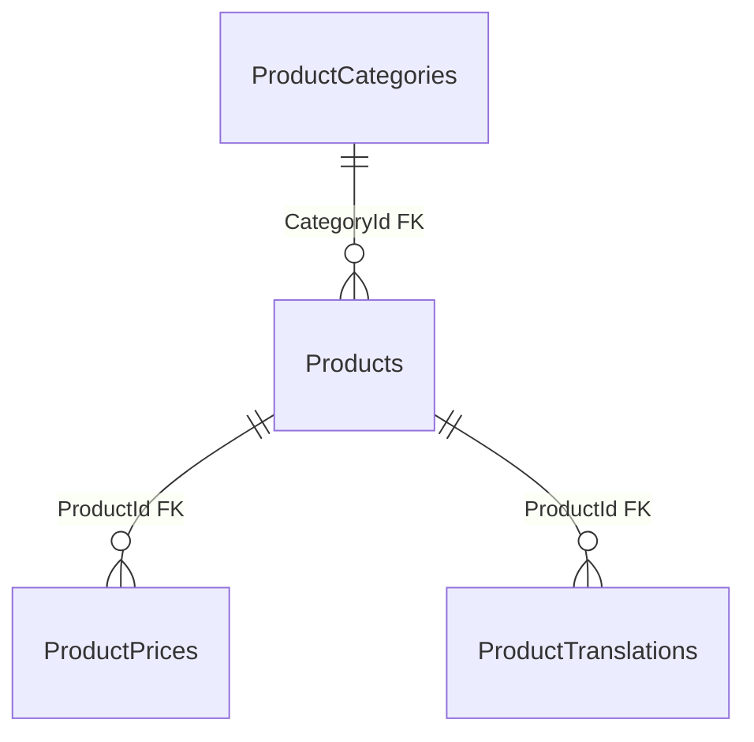

# Catalog — товари й ціни: дані

**Джерело:** [Catalog snapshot](../../../../src/Catalog/Catalog.Infrastructure/Migrations/CatalogDbContextModelSnapshot.cs) і [конфігурації](../../../../src/Catalog/Catalog.Infrastructure/Configurations/), перевірено 2026-10-21. [Назад до карти БД](README.md) · [публічні товари](../../features/catalog/public-products.md) · [імпорт 1C](../../features/catalog/one-c-import.md).

| Таблиця | PK | Призначення й важливі поля |
| --- | --- | --- |
| `Products` | `Id` | Товар: `CategoryId` (FK), `ProductSlug`, `Name`, `Photo`, ознаки публікації та видалення. |
| `ProductPrices` | `Id` | Ціна: `ProductId` (FK), `PriceTypeId`, `Amount`, `CurrencyIso`, `ProductTypeIdOneC`. |
| `ProductTranslations` | `Id` | Переклад: `ProductId` (FK), `Language`, `Name`. |
| `PriceType` | `Id` | Довідник типів цін: `PriceTypeName`; фізична назва таблиці в однині. |

`ProductPrices.PriceTypeId` є смисловим посиланням на `PriceType.Id`, але фізичний FK у snapshot відсутній. `ProductCategories` описано в [категоріях](catalog-categories.md). Проєкція списку й результат перевірки фото мають окремих [власників](README.md), тому тут не дублюються.
