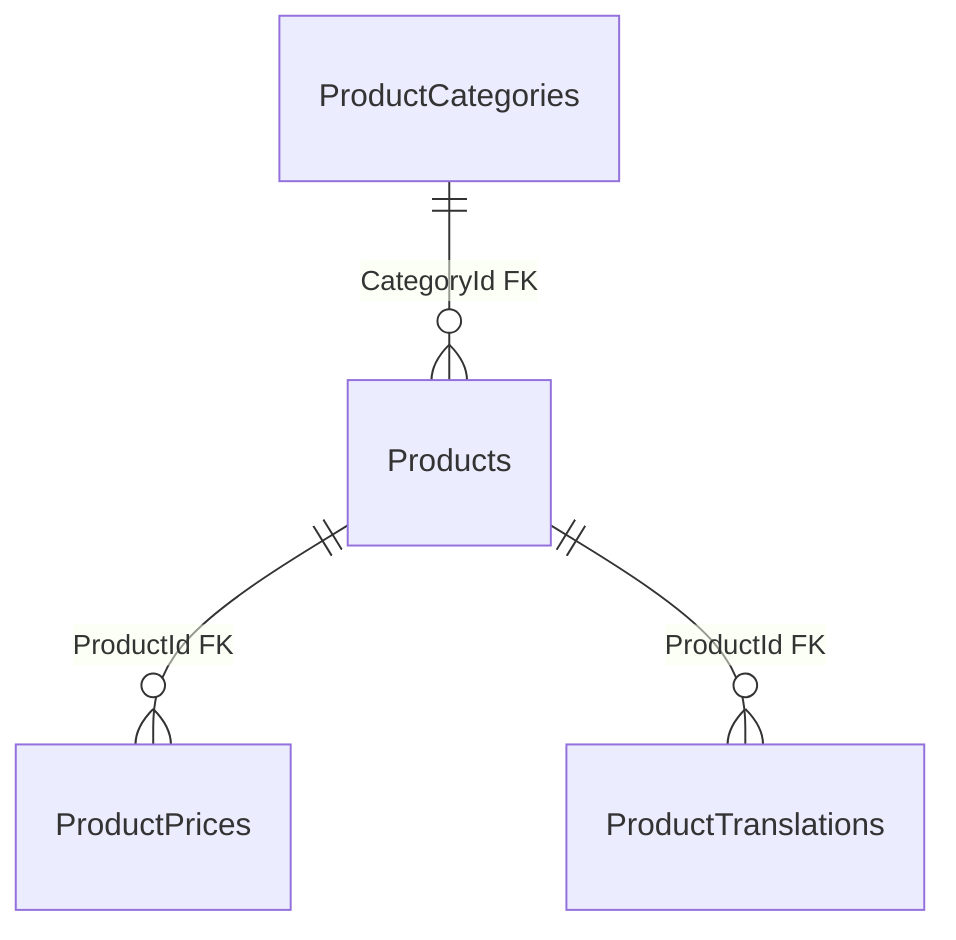

# Catalog — products and prices: data

**Source:** [Catalog snapshot](../../../../src/Catalog/Catalog.Infrastructure/Migrations/CatalogDbContextModelSnapshot.cs) and [configurations](../../../../src/Catalog/Catalog.Infrastructure/Configurations/), checked 2026-10-21. [Back to database map](README.md) · [public products](../../features/catalog/public-products.md) · [1C import](../../features/catalog/one-c-import.md).

| Table | PK | Purpose and important fields |
| --- | --- | --- |
| `Products` | `Id` | Product: `CategoryId` (FK), `ProductSlug` (unique, stable), `Name`, `Photo`, publication flags, soft delete (`IsDeleted`, `DeletedAt`). |
| `ProductPrices` | `Id` | Price: `ProductId` (FK), `PriceTypeId`, `Amount`, `CurrencyIso`, `ProductTypeIdOneC`. |
| `ProductTranslations` | `Id` | Translation: `ProductId` (FK), `Language`, `Name`. |
| `PriceType` | `Id` | Price type lookup: `PriceTypeName`; physical table name is singular. |

`ProductPrices.PriceTypeId` semantically references `PriceType.Id`, but the snapshot has no physical FK. See [categories](catalog-categories.md) for `ProductCategories`. The list projection and photo-check result have separate [owners](README.md) and are not duplicated here.
