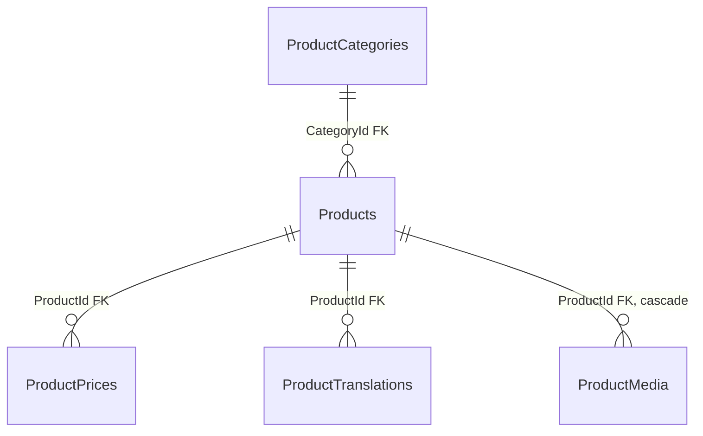

# Catalog — products and prices: data

**Source:** [Catalog snapshot](../../../../src/Catalog/Catalog.Infrastructure/Migrations/CatalogDbContextModelSnapshot.cs) and [configurations](../../../../src/Catalog/Catalog.Infrastructure/Configurations/), checked 2026-11-04. [Back to database map](README.md) · [public products](../../features/catalog/public-products.md) · [1C import](../../features/catalog/one-c-import.md).

| Table | PK | Purpose and important fields |
| --- | --- | --- |
| `Products` | `Id` | Product: `CategoryId` (FK), `ProductSlug` (unique, stable), `Name`, `Photo` and `Sсheme` (cache of the first photo and the scheme URL, empty string without them), publication flags, soft delete (`IsDeleted`, `DeletedAt`). |
| `ProductMedia` | `ProductId`, `MediaFileId` | Link to a media library file, owned by the product: `Kind` (1 photo, 2 scheme), `Position` (photo order from 0), `Url` (copy refreshed by the CDN sync run). Index on `MediaFileId`. |
| `ProductPrices` | `Id` | Price: `ProductId` (FK), `PriceTypeId`, `Amount`, `CurrencyIso`, `ProductTypeIdOneC`. |
| `ProductTranslations` | `Id` | Translation: `ProductId` (FK), `Language`, `Name`. |
| `PriceType` | `Id` | Price type lookup: `PriceTypeName`; physical table name is singular. |

`ProductPrices.PriceTypeId` semantically references `PriceType.Id`, but the snapshot has no physical FK. See [categories](catalog-categories.md) for `ProductCategories`. `ProductMedia.MediaFileId` refers to `media.MediaFiles.Id` by ID only, with no cross-module FK; Media tells Catalog about replaced and deleted files. The list projection has a separate [owner](README.md) and is not duplicated here.
