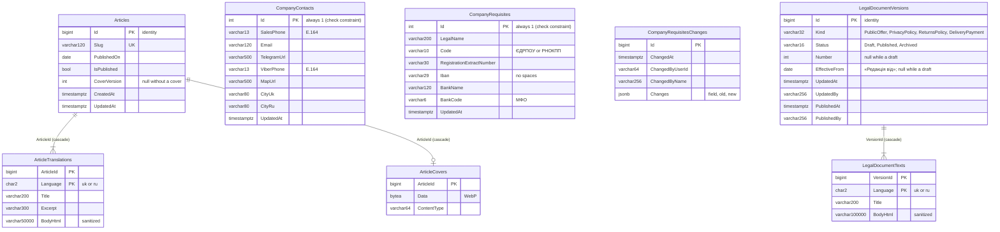

# Content: site articles, company contacts, requisites and documents

**Checked:** 2026-11-04 against `ContentDbContext` and its configurations. Schema `content`; migration history in `content."__EFMigrationsHistory"`.

Index `(IsPublished, PublishedOn)` serves the public list. The `SeedLegacyArticles` migration inserts articles 1–6 and moves the identity sequence past them. `CompanyContacts` has exactly one row, inserted by the `AddCompanyContacts` migration; `CompanyRequisites` likewise by `AddCompanyRequisites`, which also creates the change log (index on `ChangedAt`, no link to the row because there is only one). `LegalDocumentVersions` has filtered unique indexes on `Kind` for `Status = 'Draft'` and for `Status = 'Published'` (one draft and one edition on the site per document), a unique `(Kind, Number)`, and a check that a non-draft has a number, date and publish time; `SeedLegalDocuments` inserts edition 1 of each document (from 2026-11-03) and moves the identity sequence. The module has no references to other modules' tables.

Features: [Site articles](../../features/content/articles.md), [Company contacts](../../features/content/company-contacts.md), [Company requisites](../../features/content/company-requisites.md).
