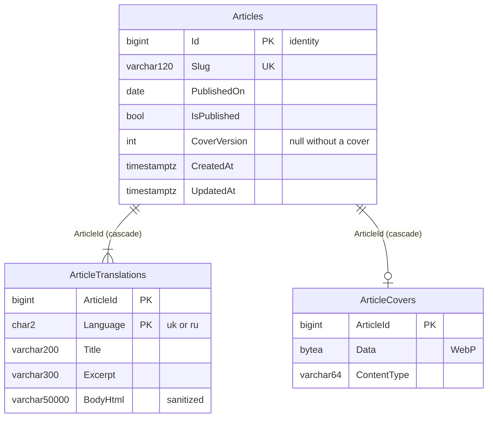

# Content: site articles

**Checked:** 2026-11-04 against `ContentDbContext` and its configurations. Schema `content`; migration history in `content."__EFMigrationsHistory"`.

Index `(IsPublished, PublishedOn)` serves the public list. The `SeedLegacyArticles` migration inserts articles 1–6 and moves the identity sequence past them. The module has no references to other modules' tables.

Feature: [Site articles](../../features/content/articles.md).
