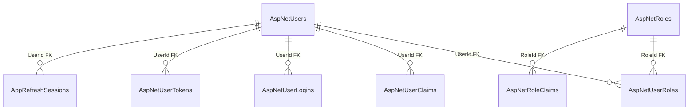

# Identity — доступ і сеанси: дані

**Джерело:** [Identity snapshot](../../../../src/Identity/Identity.Infrastructure/Migrations/AppIdentityDbContextModelSnapshot.cs) і [конфігурації](../../../../src/Identity/Identity.Infrastructure/Configuration/), перевірено 2026-10-21. [Назад до карти БД](README.md) · [фіча сеансу](../../features/identity/session.md).

| Таблиця | PK | Призначення |
| --- | --- | --- |
| `AspNetUsers` | `Id` | Користувачі та облікові дані. |
| `AspNetRoles` | `Id` | Ролі й рівні доступу. |
| `AspNetUserRoles` | `UserId`, `RoleId` | Призначення ролей користувачам. |
| `AspNetUserClaims` | `Id` | Claims користувача (`UserId` FK). |
| `AspNetRoleClaims` | `Id` | Claims ролі (`RoleId` FK). |
| `AspNetUserLogins` | `LoginProvider`, `ProviderKey` | Зовнішні входи (`UserId` FK). |
| `AspNetUserTokens` | `UserId`, `LoginProvider`, `Name` | Токени (`UserId` FK). |
| `AppRefreshSessions` | `Id` | Refresh-сесії (`UserId` FK). |

