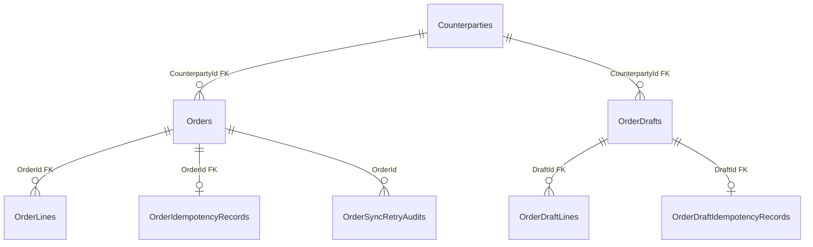
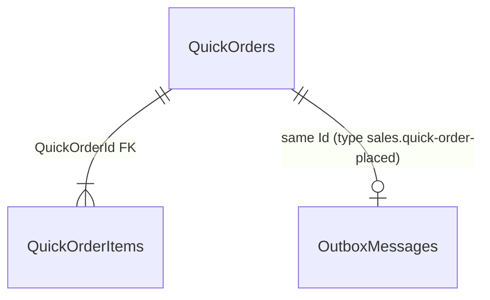

# Sales — orders and 1C: data

**Source:** [Sales snapshot](../../../../src/Modules/Sales/Sales.Infrastructure/Migrations/SalesDbContextModelSnapshot.cs) and [configurations](../../../../src/Modules/Sales/Sales.Infrastructure/Persistence/), checked 2026-11-24. [Back to database map](README.md) · [orders feature](../../features/sales/admin-orders.md).

| Table | PK | Purpose and important fields |
| --- | --- | --- |
| `Orders` | `Id` | Order: `CounterpartyId` (FK), `OrderNumber`, `CreatedAt`, `Comment`; 1C answer `OneCDocumentNumber` + `OneCAcceptedAtUtc` or `OneCRejection` + `OneCRejectedAtUtc`; `OneCMessageId` (unique) is the id of its `sales."OutboxMessages"` row, which holds attempts and errors ([platform spec 006](../../specs/platform/006-transactional-outbox/README.md)). |
| `OrderLines` | `Id` | Lines: `OrderId` (FK), `ProductId`, `ProductName`, `Quantity`, `Amount` (final, including any adjustment), `PriceAdjustment` (UAH per unit, discount < 0, markup > 0, default 0). |
| `OrderIdempotencyRecords` | `Id` | Request key and hash; `OrderId` (FK); expired rows are deleted on each order create (index on `ExpiresAtUtc`). |
| `OrderSyncRetryAudits` | `Id` | Manual retry audit: `OrderId`, previous state, reason, who and when. |
| `OrderDrafts` | `Id` | Separate saved drafts: `CounterpartyId` (FK), `Title`, `Note`, `Version`, creation/update times; no Order number. |
| `OrderDraftLines` | `Id` | Lines: `DraftId` (FK), `ProductId`, positive `Quantity`, `PriceAdjustment` (UAH per unit, default 0); `DraftId/ProductId` pair is unique. |
| `OrderDraftIdempotencyRecords` | `Id` | Draft creation request key and hash, `DraftId` (FK). |

`OrderLines.ProductId` references a Catalog product by ID without a physical FK in the Sales snapshot. `Orders.OneCMessageId` points to the outbox row without a physical FK, because the outbox deletes processed rows after 30 days. See [customer data](sales-customers.md) for `Counterparties`.

## Site orders

[Spec sales/009](../../specs/sales/009-site-orders-in-admin/README.md) · [site quick order feature](../../features/sales/quick-order.md).

| Table | PK | Purpose and important fields |
| --- | --- | --- |
| `QuickOrders` | `Id` (uuid, the site's `Idempotency-Key`) | An order sent from the site: `FirstName`, `Phone` (personal data, kept like Sales orders, never logged), `PlacedAtUtc`, `Total` (copy of the cart, not a charge); Telegram delivery `TelegramSentAtUtc`, `TelegramLastAttemptAtUtc`, `TelegramLastError`, `TelegramFailedAtUtc` (outbox gave up); `xmin` row version for the resend. Indexes: `IX_QuickOrders_PlacedAtUtc_Id` (list), trigram `IX_QuickOrders_FirstName_trgm` and `IX_QuickOrders_Phone_trgm` (search), partial `IX_QuickOrders_Problem` (not delivered with an error or given up). |
| `QuickOrderItems` | `Id` | Cart lines: `QuickOrderId` (FK, cascade), `ProductId` (text the site sent, no Catalog reference), `Title`, `UnitPrice`, `Quantity`. |

The order's Telegram outbox message has the order's id, without a physical FK because the outbox deletes processed rows after 30 days; the order stays. Migration `AddQuickOrders` copied the site orders that existed only in the outbox at release time.
