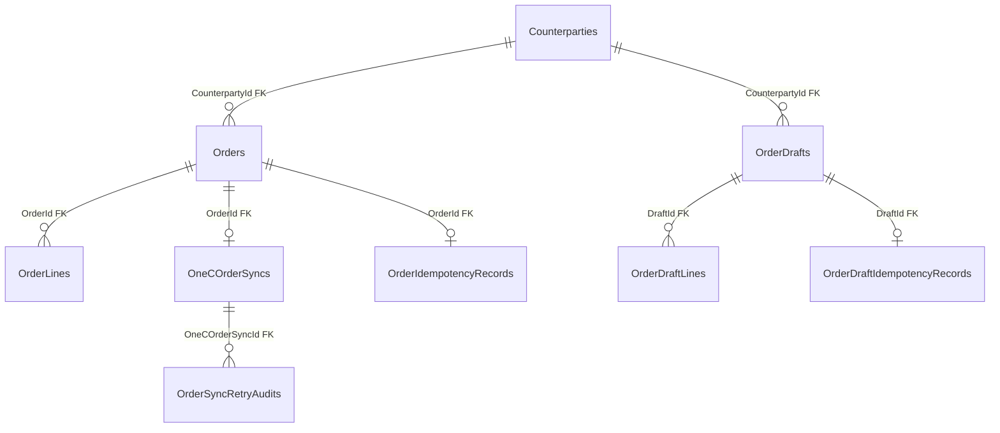

# Sales — замовлення й 1C: дані

**Джерело:** [Sales snapshot](../../../../src/Sales/Sales.Infrastructure/Migrations/SalesDbContextModelSnapshot.cs) і [конфігурації](../../../../src/Sales/Sales.Infrastructure/Configurations/), перевірено 2026-10-21. [Назад до карти БД](README.md) · [фіча замовлень](../../features/sales/admin-orders.md).

| Таблиця | PK | Призначення й важливі поля |
| --- | --- | --- |
| `Orders` | `Id` | Замовлення: `CounterpartyId` (FK), `OrderNumber`, `CreatedAt`, `Comment`. |
| `OrderLines` | `Id` | Позиції: `OrderId` (FK), `ProductId`, `ProductName`, `Quantity`, `Amount`. |
| `OneCOrderSyncs` | `Id` | Стан передачі в 1C; `OrderId` (FK). |
| `OrderIdempotencyRecords` | `Id` | Ключ і хеш повторного запиту; `OrderId` (FK). |
| `OrderSyncRetryAudits` | `Id` | Аудит retry: `OneCOrderSyncId` (FK), `OrderId`, попередній стан і причину. |
| `OrderDrafts` | `Id` | Окремі збережені чернетки: `CounterpartyId` (FK), `Title`, `Note`, `Version`, час створення й зміни; номера Order немає. |
| `OrderDraftLines` | `Id` | Позиції: `DraftId` (FK), `ProductId`, додатна `Quantity`; пара `DraftId/ProductId` унікальна. |
| `OrderDraftIdempotencyRecords` | `Id` | Ключ та хеш запиту на створення чернетки, `DraftId` (FK). |

`OrderLines.ProductId` є посиланням на товар Catalog за ID без фізичного FK у Sales snapshot. `Counterparties` описано в [даних клієнтів](sales-customers.md).
