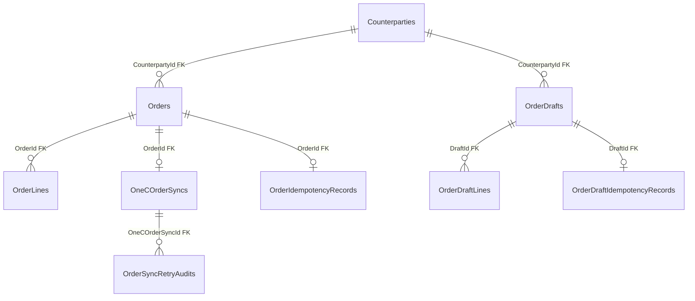

# Sales — orders and 1C: data

**Source:** [Sales snapshot](../../../../src/Sales/Sales.Infrastructure/Migrations/SalesDbContextModelSnapshot.cs) and [configurations](../../../../src/Sales/Sales.Infrastructure/Configurations/), checked 2026-10-21. [Back to database map](README.md) · [orders feature](../../features/sales/admin-orders.md).

| Table | PK | Purpose and important fields |
| --- | --- | --- |
| `Orders` | `Id` | Order: `CounterpartyId` (FK), `OrderNumber`, `CreatedAt`, `Comment`. |
| `OrderLines` | `Id` | Lines: `OrderId` (FK), `ProductId`, `ProductName`, `Quantity`, `Amount` (final, including any adjustment), `PriceAdjustment` (UAH per unit, discount < 0, markup > 0, default 0). |
| `OneCOrderSyncs` | `Id` | 1C delivery state; `OrderId` (FK). |
| `OrderIdempotencyRecords` | `Id` | Request key and hash; `OrderId` (FK). |
| `OrderSyncRetryAudits` | `Id` | Retry audit: `OneCOrderSyncId` (FK), `OrderId`, previous state and reason. |
| `OrderDrafts` | `Id` | Separate saved drafts: `CounterpartyId` (FK), `Title`, `Note`, `Version`, creation/update times; no Order number. |
| `OrderDraftLines` | `Id` | Lines: `DraftId` (FK), `ProductId`, positive `Quantity`, `PriceAdjustment` (UAH per unit, default 0); `DraftId/ProductId` pair is unique. |
| `OrderDraftIdempotencyRecords` | `Id` | Draft creation request key and hash, `DraftId` (FK). |

`OrderLines.ProductId` references a Catalog product by ID without a physical FK in the Sales snapshot. See [customer data](sales-customers.md) for `Counterparties`.
