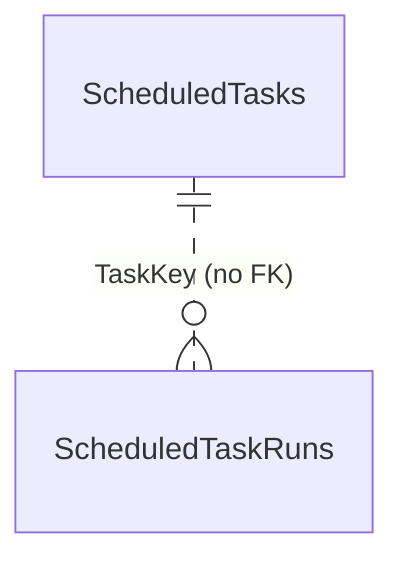

# Scheduling: background tasks

**Owner:** Scheduling (`SchedulingDbContext`, schema `scheduling`). **Feature:** [background tasks](../../features/platform/background-tasks.md).

| Table | Purpose |
| --- | --- |
| `ScheduledTasks` | One row per task key of the code catalogue: `Enabled`, `Schedule` (jsonb: kind, interval and hours or Kyiv times and weekdays), `NextRunAt`, `State` (`Idle`/`Running`), `CurrentRunId`, `RunningSince`, `RunRequestedAt`/`By`, last success (time, summary ≤ 500) and last failure (time, reason ≤ 500), `UpdatedAt`/`By`, `Version` (concurrency token of the claim). |
| `ScheduledTaskRuns` | One run: Guid v7 `Id` created by the tick and passed to the job, `TaskKey`, `Trigger` (`Schedule`/`Manual`), `RequestedBy`, `ClaimedAt`, `StartedAt`, `FinishedAt`, `Outcome`, `Message`. Index (`TaskKey`, `ClaimedAt` desc); runs older than 90 days are deleted by the tick. |

Rows are created by the tick for catalogue keys that have none; a key removed from the catalogue keeps its row, which is ignored. There are no foreign keys to other modules.
