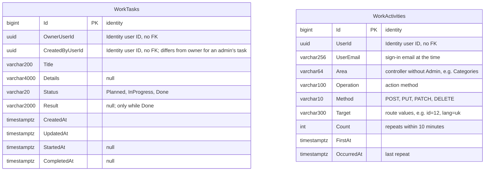

# Work: tasks and activity

**Checked:** 2026-11-06 against `WorkDbContext` and its configurations. Schema `work`; migration history in `work."__EFMigrationsHistory"`.

Indexes: `WorkTasks(OwnerUserId, Status)` for the board, `WorkTasks(OwnerUserId, CompletedAt)` for the report, `WorkActivities(UserId, OccurredAt)` for the report and the merge of repeats. User IDs reference Identity's `AspNetUsers.Id` as values only, by the [module rules](../../standards/module-rules.md).
