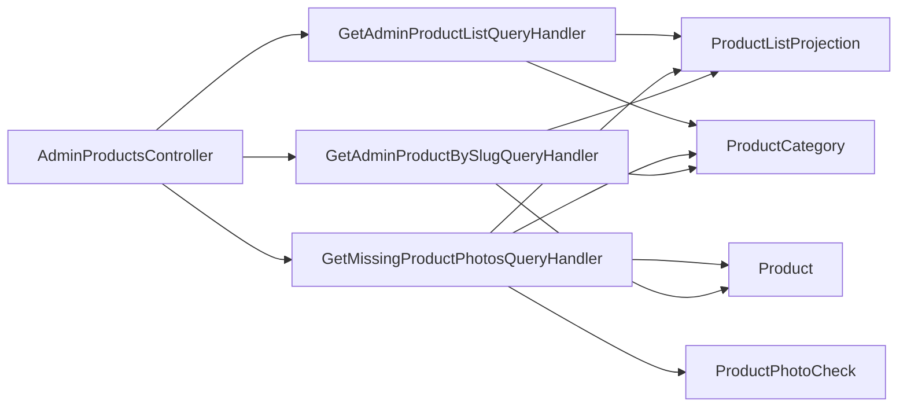

# Admin products and photos

**Static code check:** 2026-10-19. **Module:** Catalog.

Paged and full product lists, search for missing/invalid photos, and Admin product details by slug.

## Structure and relationships

[AdminProductsController](../../../../src/Catalog/Catalog.Api/Controllers/AdminProductsController.cs) dispatches reads to the [list handler](../../../../src/Catalog/Catalog.Application/Features/Products/GetAdminList/GetAdminProductListQueryHandler.cs), [photo handler](../../../../src/Catalog/Catalog.Application/Features/Products/GetMissingPhotos/GetMissingProductPhotosQueryHandler.cs), or [details handler](../../../../src/Catalog/Catalog.Application/Features/Products/GetAdminDetail/GetAdminProductBySlugQueryHandler.cs). Lists apply server-side filters and search before counting and paging; boolean parameters distinguish missing, `true`, and `false`. The photo list combines ProductListProjection, Product, and [ProductPhotoCheck](../../../../src/Catalog/Catalog.Domain/Entities/ProductPhotoCheck.cs). Details combine the projection, Product, and category by slug, returning both names, scheme, and flags. HTTP product changes are not implemented here.

For the no-photo list, stable sorting and `Skip/Take` operate on mapped ProductListProjection fields before DTO conversion. This preserves server-side paging and an EF Core-translatable SQL query. A PostgreSQL regression test was added for this path but was skipped locally as Docker was unavailable on 2026-10-19.

Both paged Admin lists return `categoryName` from the category's Ukrainian short name, accept `categoryId` including all descendants, and sort `CategoryAsc/CategoryDesc` before paging. The [tree traversal helper](../../../../src/Catalog/Catalog.Application/Features/Products/AdminProductCategoryIds.cs) stops cycles with a visited-ID set. `GET /api/categories` provides the complete ordered lookup for the Admin selector. Changes are specified in the [category SDD](../../specs/catalog/admin-product-list/category-table-2026-10-19.md).

## Code structure

The tree lists verified entry points and key feature components; it does not include every supporting file.

```text
src/
└── Catalog/
    ├── Catalog.Api/Controllers/AdminProductsController.cs  # HTTP entry point
    ├── Catalog.Application/Features/Products/
    │   ├── AdminProductCategoryIds.cs  # descendant IDs for Admin filtering
    │   ├── GetAdminList/
    │   │   ├── GetAdminProductListQueryHandler.cs  # use-case handler
    │   │   └── GetAllAdminProductsQueryHandler.cs  # use-case handler
    │   ├── GetMissingPhotos/GetMissingProductPhotosQueryHandler.cs  # use-case handler
    │   └── GetAdminDetail/GetAdminProductBySlugQueryHandler.cs  # details by slug
    └── Catalog.Domain/Entities/ProductPhotoCheck.cs  # domain model
```

## Structure diagram



## Related sources

[Contract](../../contracts/catalog/products.openapi.yaml) · [Product list SDD](../../specs/catalog/admin-product-list/README.md) · [Photo SDD](../../specs/catalog/003-missing-product-photos/README.md) · [Product details SDD](../../specs/catalog/004-admin-product-detail/README.md).
