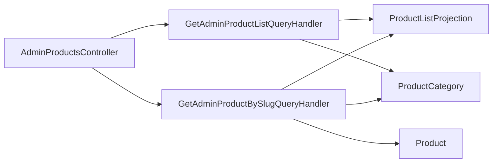

# Admin products

**Static code check:** 2026-11-04. **Module:** Catalog.

Paged and full product lists, Admin product details by slug, deleted products, and slug edit. Photos and schemes are a separate card: [product photos and schemes](product-media.md).

## Structure and relationships

[AdminProductsController](../../../../src/Catalog/Catalog.Api/Controllers/AdminProductsController.cs) dispatches reads to the [list handler](../../../../src/Catalog/Catalog.Application/Features/Products/GetAdminList/GetAdminProductListQueryHandler.cs) or [details handler](../../../../src/Catalog/Catalog.Application/Features/Products/GetAdminDetail/GetAdminProductBySlugQueryHandler.cs). Lists apply server-side filters and search before counting and paging; boolean parameters distinguish missing, `true`, and `false`. `withoutPhoto=true` keeps rows whose cached photo is empty. Details combine the projection, Product, and category by slug, returning both names, scheme, and flags. HTTP product changes are not implemented here.

Both paged Admin lists return `categoryName` from the category's Ukrainian short name, accept `categoryId` including all descendants, and sort `CategoryAsc/CategoryDesc` before paging. The [tree traversal helper](../../../../src/Catalog/Catalog.Application/Features/Category/CategoryTreeIds.cs) stops cycles with a visited-ID set. `GET /api/categories` provides the complete ordered lookup for the Admin selector. Changes are specified in the [category SDD](../../specs/catalog/admin-product-list/category-table-2026-10-19.md).

Soft-deleted products leave the projection, so ordinary lists never show them. With `deleted=true` (Admin or Seo role only; Manager gets `403`) the list reads [deleted products](../../../../src/Catalog/Catalog.Application/Features/Products/GetAdminList/DeletedAdminProducts.cs) directly, newest deletion first. `PUT /api/admin/products/{id}/slug` (`CanManageSiteCatalog`: Admin or Seo) sets or regenerates the slug through the [slug command](../../../../src/Catalog/Catalog.Application/Features/Slugs/Change/ChangeSlugCommandHandler.cs); the old slug goes to history and the projection row follows.

## Code structure

The tree lists verified entry points and key feature components; it does not include every supporting file.

```text
src/
└── Catalog/
    ├── Catalog.Api/Controllers/AdminProductsController.cs  # HTTP entry point
    ├── Catalog.Application/Features/Products/
    │   ├── GetAdminList/
    │   │   ├── DeletedAdminProducts.cs  # Admin and Seo deleted list
    │   │   ├── GetAdminProductListQueryHandler.cs  # use-case handler
    │   │   └── GetAllAdminProductsQueryHandler.cs  # use-case handler
    │   └── GetAdminDetail/GetAdminProductBySlugQueryHandler.cs  # details by slug
    └── Catalog.Domain/Entities/Product.cs  # domain model
```

## Structure diagram



## Tests

[ApiContractTests.cs](../../../../tests/IntegrationTests/Platform/Api/ApiContractTests.cs) · [ProductMediaApiTests.cs](../../../../tests/IntegrationTests/Catalog/ProductMedia/ProductMediaApiTests.cs) (`withoutPhoto`) · [CatalogStableUrlsApiTests.cs](../../../../tests/IntegrationTests/Catalog/Api/CatalogStableUrlsApiTests.cs)

Focused run: `dotnet test tests/IntegrationTests/IntegrationTests.csproj --filter "FullyQualifiedName~CatalogStableUrlsApiTests|FullyQualifiedName~ProductMediaApiTests"`.

## Related sources

[Contract](../../contracts/catalog/products.openapi.yaml) · [Product list SDD](../../specs/catalog/admin-product-list/README.md) · [Photo SDD (history, replaced by Media 001 stage 3)](../../specs/catalog/003-missing-product-photos/README.md) · [Product details SDD](../../specs/catalog/004-admin-product-detail/README.md) · [Stable URLs SDD](../../specs/catalog/005-stable-urls-and-category-content/README.md).
