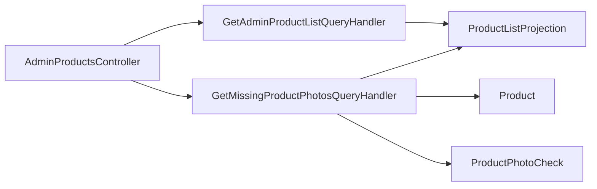

# Admin-товари й фото

**Статична звірка з кодом:** 2026-10-16. **Модуль:** catalog.

Сторінковий і повний списки товарів та пошук відсутніх/некоректних фото.

## Будова й зв'язки

[AdminProductsController](../../../../src/Catalog/Catalog.Api/Controllers/AdminProductsController.cs) передає читання [handler списку](../../../../src/Catalog/Catalog.Application/Features/Products/GetAdminList/GetAdminProductListQueryHandler.cs) або [handler фото](../../../../src/Catalog/Catalog.Application/Features/Products/GetMissingPhotos/GetMissingProductPhotosQueryHandler.cs). Останній поєднує ProductListProjection, Product і [ProductPhotoCheck](../../../../src/Catalog/Catalog.Domain/Entities/ProductPhotoCheck.cs). HTTP-зміни товарів тут немає.

## Структура в коді

Наведено перевірені точки входу та ключові складові фічі; дерево не перелічує всі допоміжні файли.

```text
src/
└── Catalog/
    ├── Catalog.Api/Controllers/AdminProductsController.cs  # HTTP-вхід
    ├── Catalog.Application/Features/Products/
    │   ├── GetAdminList/
    │   │   ├── GetAdminProductListQueryHandler.cs  # обробник сценарію
    │   │   └── GetAllAdminProductsQueryHandler.cs  # обробник сценарію
    │   └── GetMissingPhotos/GetMissingProductPhotosQueryHandler.cs  # обробник сценарію
    └── Catalog.Domain/Entities/ProductPhotoCheck.cs  # доменна модель
```

## Схема будови



## Пов'язані джерела

[Контракт](../../contracts/catalog/products.openapi.yaml) · [SDD списку](../../specs/catalog/admin-product-list/README.md) · [SDD фото](../../specs/catalog/003-missing-product-photos/README.md).
