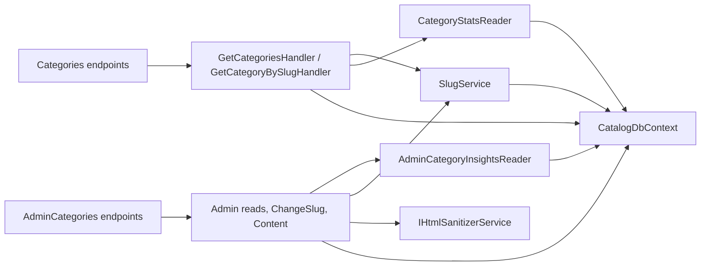

# Catalog categories

**Static code check:** 2026-11-26. **Module:** Catalog.

Public tree and category page by slug, Admin reads, Admin slug edit, Admin-written SEO text and FAQ per language, the Admin «show on site» mark, and the search settings: «Закрити від пошуку», site names, and the link-preview picture, and managing the tree by hand: manual categories, moving any category, order, and site models put into a category.

## Structure and relationships

The [public endpoints](../../../../src/Modules/Catalog/Catalog.Api/Endpoints/Categories/CategoriesEndpoints.cs) and [admin endpoints](../../../../src/Modules/Catalog/Catalog.Api/Endpoints/Categories/CategoriesEndpoints.cs) dispatch to Application handlers. [ProductCategory](../../../../src/Modules/Catalog/Catalog.Domain/Categories/ProductCategory.cs) is soft-deleted by the 1C import (a global query filter hides it) and keeps its slug for life; former slugs live in [SlugHistoryEntry](../../../../src/Modules/Catalog/Catalog.Domain/Slugs/SlugHistoryEntry.cs) and resolve through [SlugService](../../../../src/Modules/Catalog/Catalog.Application/Features/Slugs/Shared/SlugService.cs). Product counts and the price range come from the product list projection through [CategoryStatsReader](../../../../src/Modules/Catalog/Catalog.Application/Features/Categories/Shared/Stats/CategoryStatsReader.cs) and [CategoryStatsRollup](../../../../src/Modules/Catalog/Catalog.Application/Features/Categories/Shared/Stats/CategoryStatsRollup.cs). [CategoryContent](../../../../src/Modules/Catalog/Catalog.Domain/Categories/Content/CategoryContent.cs) holds SEO title, meta description, H1, sanitized body, and FAQ per language; the body passes the [HTML sanitizer](../../../../src/Modules/Catalog/Catalog.Infrastructure/Integrations/Html/HtmlSanitizerService.cs) on save. The public tree and category page show only categories marked `IsShownOnSite` and never the Cosmos import root ([PublicCatalogScope](../../../../src/Modules/Catalog/Catalog.Application/Features/Categories/Shared/PublicCatalogScope.cs)): the tree omits the others and their slugs answer `404`; admin reads still list them.

**Show on site** ([spec 007 R-18](../../specs/catalog/007-site-models/README.md#stage-4b-categories-on-the-site-and-the-showcase-by-model)): an Admin sets the mark with `PUT api/categories/{id}/site-visibility` ([handler](../../../../src/Modules/Catalog/Catalog.Application/Features/Categories/Commands/SetCategorySiteVisibility/SetCategorySiteVisibilityHandler.cs)). Hiding takes every subcategory with it; showing also shows every parent; Cosmos is never shown. The 1C category sync never changes the mark and gives a new category its parent's (a new top category is shown only in the hardware root). The migration `CategorySiteVisibility` shows the whole «Фурнітура» root (1C `000005513`) once. Hidden categories and their products also leave «Вітрина сайту», «Моделі», and the «Огляд» counts.

**Search settings** ([spec catalog/011](../../specs/catalog/011-site-search-settings/README.md)): `PUT api/categories/{id}/search-settings` ([handler](../../../../src/Modules/Catalog/Catalog.Application/Features/Categories/Commands/SetCategorySearchSettings/SetCategorySearchSettingsHandler.cs)) sets «Закрити від пошуку» for the category and every subcategory ([CategorySearchClosing](../../../../src/Modules/Catalog/Catalog.Domain/Categories/Tree/CategorySearchClosing.cs)) and the link-preview picture (a media-library file read through `IProductMediaLibrary`); `PUT api/categories/{id}/site-names` ([handler](../../../../src/Modules/Catalog/Catalog.Application/Features/Categories/Commands/SetCategorySiteNames/SetCategorySiteNamesHandler.cs)) saves the admin's uk/ru names, which win over 1C: `ShortNameUk`/`ShortNameRu` keep the shown name, the sync keeps the admin's, and a blank name goes back to the 1C name at once. A new 1C category takes its parent's search mark. The public tree carries `isClosedFromSearch` and `updatedAt` (the later of the category's and its content's change); the category page also `shareImageUrl` and the later change date of the category and its content. The admin by-id read returns the picture's `shareImageUrl`.

**Managing the tree by hand** ([spec catalog/012](../../specs/catalog/012-manual-categories/README.md)): `POST api/categories` creates a manual category ([ProductCategory.Placement](../../../../src/Modules/Catalog/Catalog.Domain/Categories/ProductCategory.Placement.cs), ids from the `catalog."ManualCategoryIds"` sequence from 800 000 000); `PUT api/categories/{id}/parent` moves any category, 1C or manual, with its subcategories; `PUT api/categories/{id}/order` swaps it with a neighbour; `DELETE api/categories/{id}` deletes an empty manual category; `POST api/categories/{id}/site-models` puts site models into a final category. The [handlers](../../../../src/Modules/Catalog/Catalog.Application/Features/CategoryPlacement/Shared/CategoryTreeEditor.cs) rebuild every path with [CategoryTreePlacement](../../../../src/Modules/Catalog/Catalog.Domain/Categories/Tree/CategoryTreePlacement.cs) in one save. The admin's place and order win over 1C: the sync remembers the 1C parent (`OneCParentId`) but keeps a place and an order set by hand, never deletes a manual category, and rebuilds the tree after every run. Admin reads carry `isManual`.

The active admin list also carries `productCount` (all active products of the category and its descendants, on the site or not) and `filledContentLanguages` (languages with any text or FAQ), `modelCount` (site models of the category and its descendants) and `proposedModelCount` (of them, models nobody accepted yet, «Не перевірена») from [AdminCategoryInsightsReader](../../../../src/Modules/Catalog/Catalog.Application/Features/Categories/Queries/GetAdminCategories/AdminCategoryInsightsReader.cs); the Admin category table uses them for its counts and «Чого бракує». Counts roll up to ancestors through `CategoryStatsRollup.RollupCounts`. Deleted rows and the by-id read leave all four `null`.

**Cache** ([read cache](../platform/read-cache.md), ADR-0016): the public tree is kept in memory for 2 minutes per language as [CategoryTreeSnapshot](../../../../src/Modules/Catalog/Catalog.Application/Features/Categories/Shared/Tree/CategoryTreeSnapshot.cs) ([CategoryTreeCache](../../../../src/Modules/Catalog/Catalog.Application/Features/Categories/Shared/Tree/CategoryTreeCache.cs)). The «show on site» mark and a category slug change drop it on their instance at once; product counts from the 1C import show within 2 minutes.

Access: reads need `CanManageProducts`; slug edit, content save, the «show on site» mark, the search settings, the site names, and `deleted=true` need `CanManageSiteCatalog` (Admin or Seo).

## Code structure

The tree lists verified entry points and key feature components; it does not include every supporting file.

```text
src/
└── Catalog/
    ├── Catalog.Api/Endpoints/CategoryPlacement/  # spec 012: create, move, order, delete, add site models
    ├── Catalog.Api/Endpoints/Categories/
    │   ├── CategoriesEndpoints.cs  # AdminCategories group: list, by id, slug, content, site visibility; Categories group: tree, by slug
    │   ├── <UseCase>Endpoint.cs  # one per operation
    │   └── CatalogLookupActionResult.cs  # 404 with redirect body
    ├── Catalog.Application/
    │   ├── Features/Category/
    │   │   ├── AdminGetById/, AdminGetList/  # Admin reads (+ deleted filter, counts and filled languages)
    │   │   ├── Content/Get/, Content/Save/  # Admin content query and command
    │   │   ├── SiteVisibility/  # Admin «show on site» mark with subcategories and parents
    │   │   ├── Commands/SetCategorySearchSettings/, SetCategorySiteNames/  # spec 010: search mark, picture, site names
    │   │   ├── GetBySlug/GetCategoryBySlugHandler.cs  # history, redirect, counts, prices, content
    │   │   ├── GetList/GetCategoriesHandler.cs  # tree with counts, hides empty, through the read cache
    │   │   ├── Tree/CategoryTreeCache.cs, CategoryTreeSnapshot.cs  # cache entry, tag, cached read model
    │   │   ├── Stats/                   # counts and price range, rolled up the tree
    │   │   └── CategoryTreeIds.cs  # category + descendants
    │   ├── Features/CategoryPlacement/  # spec 012 commands and the shared tree editor
    │   ├── Features/Slugs/Change/  # Admin slug edit (products and categories)
    │   └── Slugs/  # transliteration, slug text, allocator, slug service
    ├── Catalog.Domain/Entities/
    │   ├── ProductCategory.cs  # soft delete, slug change
    │   ├── CategoryContent.cs, CategoryFaqItem.cs  # content and limits
    │   └── SlugHistoryEntry.cs  # former slugs
    └── Catalog.Infrastructure/
        ├── Configurations/  # CategoryContent, SlugHistoryEntry, ProductCategory mappings
        └── Content/HtmlSanitizerService.cs  # allow-list sanitizer
```

## Structure diagram



## Tests

[CategoryPresentationApplicationTests.cs](../../../../tests/UnitTests/Catalog/Application/CategoryPresentationApplicationTests.cs) · [AdminCategoriesListApplicationTests.cs](../../../../tests/UnitTests/Catalog/Application/AdminCategoriesListApplicationTests.cs) · [AdminCategoryInsightsPostgresTests.cs](../../../../tests/IntegrationTests/Catalog/Categories/AdminCategoryInsightsPostgresTests.cs) · [SlugTextTests.cs](../../../../tests/UnitTests/Catalog/Slugs/SlugTextTests.cs) · [ImportSyncTests.cs](../../../../tests/UnitTests/Catalog/Sync/ImportSyncTests.cs) · [CatalogSoftDeleteAndContentTests.cs](../../../../tests/UnitTests/Catalog/Domain/CatalogSoftDeleteAndContentTests.cs) · [CatalogStableUrlsApiTests.cs](../../../../tests/IntegrationTests/Catalog/Api/CatalogStableUrlsApiTests.cs) · [CategoryPresentationPersistenceTests.cs](../../../../tests/IntegrationTests/Catalog/Persistence/CategoryPresentationPersistenceTests.cs) · [CategorySearchSettingsTests.cs](../../../../tests/UnitTests/Catalog/Domain/Categories/CategorySearchSettingsTests.cs) · [ManualCategoryTests.cs](../../../../tests/UnitTests/Catalog/Domain/Categories/ManualCategoryTests.cs) · [CategoryPlacementTests.cs](../../../../tests/UnitTests/Catalog/Domain/Categories/CategoryPlacementTests.cs) · [CategoryPlacementApiTests.cs](../../../../tests/IntegrationTests/Catalog/Categories/CategoryPlacementApiTests.cs) · [CategoryImportPlacementTests.cs](../../../../tests/IntegrationTests/Catalog/Import/CategoryImportPlacementTests.cs) · [CategorySearchSettingsApiTests.cs](../../../../tests/IntegrationTests/Catalog/Categories/CategorySearchSettingsApiTests.cs)

Focused run: `dotnet test tests/UnitTests/UnitTests.csproj --filter "FullyQualifiedName~UnitTests.Catalog"` and `dotnet test tests/IntegrationTests/IntegrationTests.csproj --filter "FullyQualifiedName~CatalogStableUrlsApiTests"` (in-memory, no Docker).

## Related sources

[Contract](../../contracts/openapi.json) · [Stable URLs and category content SDD](../../specs/catalog/005-stable-urls-and-category-content/README.md) · [Category read SDD](../../specs/catalog/002-category-read-api/README.md) · [Category metadata SDD](../../specs/catalog/001-category-presentation-metadata/README.md) · [Manual categories SDD](../../specs/catalog/012-manual-categories/README.md).
