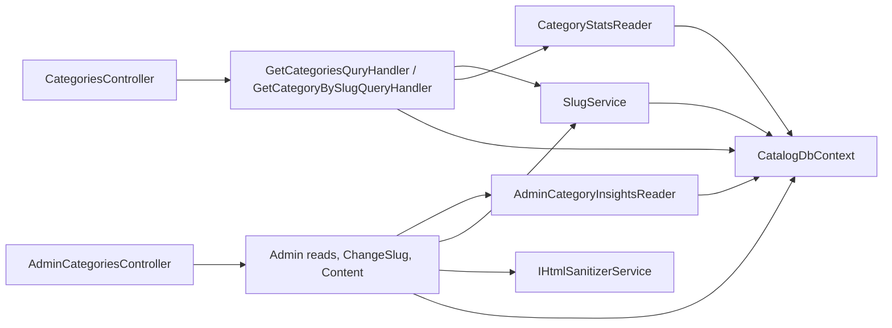

# Catalog categories

**Static code check:** 2026-11-05. **Module:** Catalog.

Public tree and category page by slug, Admin reads, Admin slug edit, Admin-written SEO text and FAQ per language, and the Admin «show on site» mark.

## Structure and relationships

The [public controller](../../../../src/Catalog/Catalog.Api/Controllers/CategoriesController.cs) and [admin controller](../../../../src/Catalog/Catalog.Api/Controllers/AdminCategoriesController.cs) dispatch to Application handlers. [ProductCategory](../../../../src/Catalog/Catalog.Domain/Categories/ProductCategory.cs) is soft-deleted by the 1C import (a global query filter hides it) and keeps its slug for life; former slugs live in [SlugHistoryEntry](../../../../src/Catalog/Catalog.Domain/Slugs/SlugHistoryEntry.cs) and resolve through [SlugService](../../../../src/Catalog/Catalog.Application/Features/Slugs/Shared/SlugService.cs). Product counts and the price range come from the product list projection through [CategoryStatsReader](../../../../src/Catalog/Catalog.Application/Features/Categories/Shared/CategoryStatsReader.cs) and [CategoryStatsRollup](../../../../src/Catalog/Catalog.Application/Features/Categories/Shared/CategoryStatsRollup.cs). [CategoryContent](../../../../src/Catalog/Catalog.Domain/Categories/Content/CategoryContent.cs) holds SEO title, meta description, H1, sanitized body, and FAQ per language; the body passes the [HTML sanitizer](../../../../src/Catalog/Catalog.Infrastructure/Integrations/Html/HtmlSanitizerService.cs) on save. The public tree and category page show only categories marked `IsShownOnSite` and never the Cosmos import root ([PublicCatalogScope](../../../../src/Catalog/Catalog.Application/Features/Categories/Shared/PublicCatalogScope.cs)): the tree omits the others and their slugs answer `404`; admin reads still list them.

**Show on site** ([spec 007 R-18](../../specs/catalog/007-site-models/README.md#stage-4b-categories-on-the-site-and-the-showcase-by-model)): an Admin sets the mark with `PUT api/categories/{id}/site-visibility` ([handler](../../../../src/Catalog/Catalog.Application/Features/Categories/Commands/SetCategorySiteVisibility/SetCategorySiteVisibilityCommandHandler.cs)). Hiding takes every subcategory with it; showing also shows every parent; Cosmos is never shown. The 1C category sync never changes the mark and gives a new category its parent's (a new top category is shown only in the hardware root). The migration `CategorySiteVisibility` shows the whole «Фурнітура» root (1C `000005513`) once. Hidden categories and their products also leave «Вітрина сайту», «Моделі», and the «Огляд» counts.

The active admin list also carries `productCount` (all active products of the category and its descendants, on the site or not) and `filledContentLanguages` (languages with any text or FAQ) from [AdminCategoryInsightsReader](../../../../src/Catalog/Catalog.Application/Features/Categories/Queries/GetAdminCategories/AdminCategoryInsightsReader.cs); the Admin tree uses them to show counts and mark categories without texts. Deleted rows and the by-id read leave both `null`.

Access: reads need `CanManageProducts`; slug edit, content save, the «show on site» mark, and `deleted=true` need `CanManageSiteCatalog` (Admin or Seo).

## Code structure

The tree lists verified entry points and key feature components; it does not include every supporting file.

```text
src/
└── Catalog/
    ├── Catalog.Api/Controllers/
    │   ├── AdminCategoriesController.cs  # Admin HTTP: list, by id, slug, content, site visibility
    │   ├── CategoriesController.cs  # public HTTP: tree, by slug
    │   └── CatalogLookupActionResult.cs  # 404 with redirect body
    ├── Catalog.Application/
    │   ├── Features/Category/
    │   │   ├── AdminGetById/, AdminGetList/  # Admin reads (+ deleted filter, counts and filled languages)
    │   │   ├── Content/Get/, Content/Save/  # Admin content query and command
    │   │   ├── SiteVisibility/  # Admin «show on site» mark with subcategories and parents
    │   │   ├── GetBySlug/GetCategoryBySlugQueryHandler.cs  # history, redirect, counts, prices, content
    │   │   ├── GetList/GetCategoriesQuryHandler.cs  # tree with counts, hides empty
    │   │   ├── Stats/                   # counts and price range, rolled up the tree
    │   │   └── CategoryTreeIds.cs  # category + descendants
    │   ├── Features/Slugs/Change/  # Admin slug edit (products and categories)
    │   └── Slugs/  # transliteration, slug text, allocator, slug service
    ├── Catalog.Domain/Entities/
    │   ├── ProductCategory.cs  # soft delete, slug change
    │   ├── CategoryContent.cs, CategoryFaqItem.cs  # content and limits
    │   └── SlugHistoryEntry.cs  # former slugs
    └── Catalog.Infrastructure/
        ├── Configurations/  # CategoryContent, SlugHistoryEntry, ProductCategory mappings
        └── Content/HtmlSanitizerService.cs  # allow-list sanitizer
```

## Structure diagram



## Tests

[CategoryPresentationApplicationTests.cs](../../../../tests/UnitTests/Catalog/Application/CategoryPresentationApplicationTests.cs) · [AdminCategoriesListApplicationTests.cs](../../../../tests/UnitTests/Catalog/Application/AdminCategoriesListApplicationTests.cs) · [AdminCategoryInsightsPostgresTests.cs](../../../../tests/IntegrationTests/Catalog/Categories/AdminCategoryInsightsPostgresTests.cs) · [SlugTextTests.cs](../../../../tests/UnitTests/Catalog/Slugs/SlugTextTests.cs) · [ImportSyncTests.cs](../../../../tests/UnitTests/Catalog/Sync/ImportSyncTests.cs) · [CatalogSoftDeleteAndContentTests.cs](../../../../tests/UnitTests/Catalog/Domain/CatalogSoftDeleteAndContentTests.cs) · [CatalogStableUrlsApiTests.cs](../../../../tests/IntegrationTests/Catalog/Api/CatalogStableUrlsApiTests.cs) · [CategoryPresentationPersistenceTests.cs](../../../../tests/IntegrationTests/Catalog/Persistence/CategoryPresentationPersistenceTests.cs)

Focused run: `dotnet test tests/UnitTests/UnitTests.csproj --filter "FullyQualifiedName~UnitTests.Catalog"` and `dotnet test tests/IntegrationTests/IntegrationTests.csproj --filter "FullyQualifiedName~CatalogStableUrlsApiTests"` (in-memory, no Docker).

## Related sources

[Contract](../../contracts/catalog/category-read.openapi.yaml) · [Stable URLs and category content SDD](../../specs/catalog/005-stable-urls-and-category-content/README.md) · [Category read SDD](../../specs/catalog/002-category-read-api/README.md) · [Category metadata SDD](../../specs/catalog/001-category-presentation-metadata/README.md).
