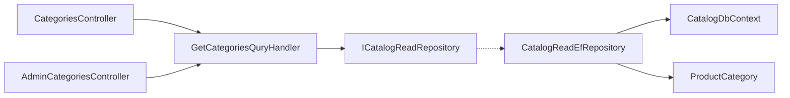

# Catalog categories

**Static code check:** 2026-10-16. **Module:** Catalog.

Public list and details by slug, plus separate admin reads.

## Structure and relationships

The [public controller](../../../../src/Catalog/Catalog.Api/Controllers/CategoriesController.cs) and [admin controller](../../../../src/Catalog/Catalog.Api/Controllers/AdminCategoriesController.cs) dispatch requests to the [Application handler](../../../../src/Catalog/Catalog.Application/Features/Category/GetList/GetCategoriesQuryHandler.cs). [ProductCategory](../../../../src/Catalog/Catalog.Domain/Entities/ProductCategory.cs) is stored through [CatalogDbContext](../../../../src/Catalog/Catalog.Infrastructure/DataBase/CatalogDbContext.cs). This is a read API; category changes are not implemented here.

## Code structure

The tree lists verified entry points and key feature components; it does not include every supporting file.

```text
src/
└── Catalog/
    ├── Catalog.Api/Controllers/
    │   ├── AdminCategoriesController.cs  # HTTP entry point
    │   └── CategoriesController.cs  # HTTP entry point
    ├── Catalog.Application/Features/Category/
    │   ├── AdminGetById/GetAdminCategoryByIdQueryHandler.cs  # use-case handler
    │   ├── AdminGetList/GetAdminCategoriesQueryHandler.cs  # use-case handler
    │   ├── GetBySlug/GetCategoryBySlugQueryHandler.cs  # use-case handler
    │   └── GetList/GetCategoriesQuryHandler.cs  # use-case handler
    ├── Catalog.Domain/Entities/ProductCategory.cs  # domain model
    └── Catalog.Infrastructure/DataBase/CatalogDbContext.cs  # data context
```

## Structure diagram



## Tests

[ProductCategoryPresentationMetadataTests.cs](../../../../tests/UnitTests/Catalog/Domain/ProductCategoryPresentationMetadataTests.cs) · [CategoryPresentationApplicationTests.cs](../../../../tests/UnitTests/Catalog/Application/CategoryPresentationApplicationTests.cs) · [SlugTests.cs](../../../../tests/UnitTests/Catalog/Application/SlugTests.cs) · [CategoryPresentationPersistenceTests.cs](../../../../tests/IntegrationTests/Catalog/Persistence/CategoryPresentationPersistenceTests.cs)

Focused run: `dotnet test tests/UnitTests/UnitTests.csproj --filter "FullyQualifiedName~CategoryPresentation"` and `dotnet test tests/IntegrationTests/IntegrationTests.csproj --filter "FullyQualifiedName~CategoryPresentation"`.

## Related sources

[Contract](../../contracts/catalog/category-read.openapi.yaml) · [Category read SDD](../../specs/catalog/002-category-read-api/README.md) · [Category metadata SDD](../../specs/catalog/001-category-presentation-metadata/README.md).
