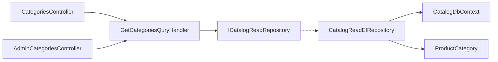

# Категорії каталогу

**Статична звірка з кодом:** 2026-10-16. **Модуль:** catalog.

Публічний список і деталі за slug, а також окреме admin-читання.

## Будова й зв'язки

[Публічний controller](../../../../src/Catalog/Catalog.Api/Controllers/CategoriesController.cs) і [admin controller](../../../../src/Catalog/Catalog.Api/Controllers/AdminCategoriesController.cs) передають запити до [Application handler](../../../../src/Catalog/Catalog.Application/Features/Category/GetList/GetCategoriesQuryHandler.cs). [ProductCategory](../../../../src/Catalog/Catalog.Domain/Entities/ProductCategory.cs) зберігається через [CatalogDbContext](../../../../src/Catalog/Catalog.Infrastructure/DataBase/CatalogDbContext.cs). Це read API; зміни категорій тут не реалізовані.

## Структура в коді

Наведено перевірені точки входу та ключові складові фічі; дерево не перелічує всі допоміжні файли.

```text
src/
└── Catalog/
    ├── Catalog.Api/Controllers/
    │   ├── AdminCategoriesController.cs  # HTTP-вхід
    │   └── CategoriesController.cs  # HTTP-вхід
    ├── Catalog.Application/Features/Category/
    │   ├── AdminGetById/GetAdminCategoryByIdQueryHandler.cs  # обробник сценарію
    │   ├── AdminGetList/GetAdminCategoriesQueryHandler.cs  # обробник сценарію
    │   ├── GetBySlug/GetCategoryBySlugQueryHandler.cs  # обробник сценарію
    │   └── GetList/GetCategoriesQuryHandler.cs  # обробник сценарію
    ├── Catalog.Domain/Entities/ProductCategory.cs  # доменна модель
    └── Catalog.Infrastructure/DataBase/CatalogDbContext.cs  # контекст даних
```

## Схема будови



## Пов'язані джерела

[Контракт](../../contracts/catalog/category-read.openapi.yaml) · [SDD читання](../../specs/catalog/002-category-read-api/README.md) · [SDD метаданих](../../specs/catalog/001-category-presentation-metadata/README.md).
