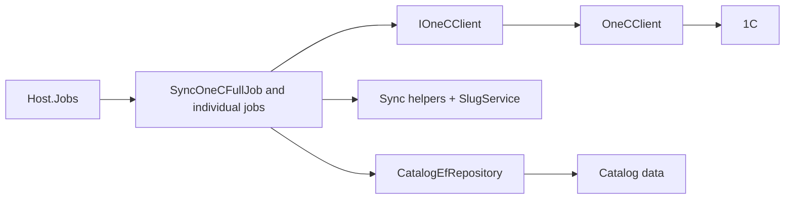

# 1C catalog import

**Static code check:** 2026-10-30. **Module:** Catalog.

Background import of categories, product details, prices, price types, and stock.

## Structure and relationships

[Host.Jobs](../../../../src/Bootstrapper/Host.Jobs/Host.Jobs/Program.cs) runs the [full job](../../../../src/Catalog/Catalog.Application/Integrations/OneC/Jobs/SyncOneCFullJob.cs) and individual jobs. The [client contract](../../../../src/Catalog/Catalog.Application/Integrations/OneC/Contracts/IOneCClient.cs) isolates 1C; [OneCClient](../../../../src/Catalog/Catalog.Infrastructure/Integrations/OneC/Client/OneCClient.cs) implements access; [CatalogEfRepository](../../../../src/Catalog/Catalog.Infrastructure/Repositories/CatalogEfRepository.cs) persists data.

The [category job](../../../../src/Catalog/Catalog.Application/Integrations/OneC/Jobs/SyncOneCCategoryJob.cs) and [product details job](../../../../src/Catalog/Catalog.Application/Integrations/OneC/Jobs/SyncOneCProductDetailsJob.cs) load every row of the root once (deleted ones included), compare in memory, and save once:

- a row changes only when a 1C field changed;
- a row missing from a non-empty 1C response is soft-deleted, unless that would delete more than 30% of the root's active rows ([MassDeletionGuard](../../../../src/Catalog/Catalog.Application/Integrations/OneC/Sync/MassDeletionGuard.cs));
- a returning row is restored with its old slug;
- a slug is created once, for new rows only, through [SlugService](../../../../src/Catalog/Catalog.Application/Slugs/SlugService.cs), and is never rewritten by the import.

Products find their category by name through [CategoryNameMap](../../../../src/Catalog/Catalog.Application/Integrations/OneC/Sync/CategoryNameMap.cs): a missing or ambiguous name keeps the current category (or skips a new product) and is reported in one warning. Each phase logs its duration and counters through [ImportCounters](../../../../src/Catalog/Catalog.Application/Integrations/OneC/Sync/ImportCounters.cs). The projection rebuild leaves out products of deleted categories.

## Code structure

The tree lists verified entry points and key components, not every supporting file.

```text
src/
├── Bootstrapper/Host.Jobs/Host.Jobs/Program.cs  # runs the job (incl. migrate-slugs)
└── Catalog/
    ├── Catalog.Application/
    │   ├── Integrations/OneC/
    │   │   ├── Contracts/IOneCClient.cs  # port and contract
    │   │   ├── Jobs/  # full, category, product details, stocks, prices, price types
    │   │   └── Sync/  # counters, deletion guard, name map, manual hierarchy, translations
    │   └── Jobs/Slugs/MigrateLegacySlugsJob.cs  # one-off move to stable slugs
    └── Catalog.Infrastructure/
        ├── Integrations/OneC/Client/OneCClient.cs  # infrastructure implementation
        ├── Projections/ProductListProjectionRebuilder.cs  # list projection
        └── Repositories/CatalogEfRepository.cs  # data access
```

## Structure diagram



## Tests

[CosmosProductMappingTests.cs](../../../../tests/UnitTests/Catalog/Application/CosmosProductMappingTests.cs) · [ImportSyncTests.cs](../../../../tests/UnitTests/Catalog/Sync/ImportSyncTests.cs) · [ProductImportSoftDeleteTests.cs](../../../../tests/IntegrationTests/Catalog/Import/ProductImportSoftDeleteTests.cs) · [CategoryImportSoftDeleteTests.cs](../../../../tests/IntegrationTests/Catalog/Import/CategoryImportSoftDeleteTests.cs)

The 1C client itself has no automated tests; the import tests use a fake client and an in-memory database.

Focused run: `dotnet test tests/UnitTests/UnitTests.csproj --filter "FullyQualifiedName~UnitTests.Catalog"` and `dotnet test tests/IntegrationTests/IntegrationTests.csproj --filter "FullyQualifiedName~IntegrationTests.Catalog.Import"`.

## Related sources

[CLI](../../operations/jobs/host-jobs-cli.md) · [Import flow](../../architecture/integrations/one-c/catalog-import-flow.md) · [Root SDD](../../specs/catalog/cosmos-one-c-root/README.md) · [Stable URLs SDD](../../specs/catalog/005-stable-urls-and-category-content/README.md).
