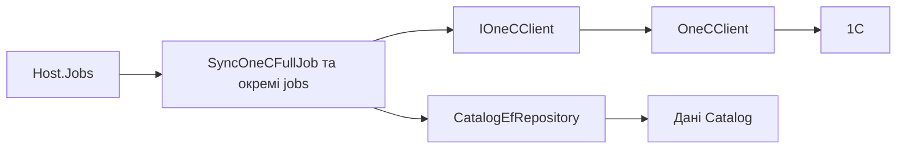

# Імпорт каталогу з 1C

**Статична звірка з кодом:** 2026-10-16. **Модуль:** catalog.

Фоновий імпорт категорій, деталей товарів, цін, типів цін і залишків.

## Будова й зв'язки

[Host.Jobs](../../../../src/Bootstrapper/Host.Jobs/Host.Jobs/Program.cs) запускає [full job](../../../../src/Catalog/Catalog.Application/Integrations/OneC/Jobs/SyncOneCFullJob.cs) та окремі jobs. [Контракт клієнта](../../../../src/Catalog/Catalog.Application/Integrations/OneC/Contracts/IOneCClient.cs) ізолює 1C; [OneCClient](../../../../src/Catalog/Catalog.Infrastructure/Integrations/OneC/Client/OneCClient.cs) реалізує доступ; [CatalogEfRepository](../../../../src/Catalog/Catalog.Infrastructure/Repositories/CatalogEfRepository.cs) записує дані.

## Структура в коді

Наведено перевірені точки входу та ключові складові фічі; дерево не перелічує всі допоміжні файли.

```text
src/
├── Bootstrapper/Host.Jobs/Host.Jobs/Program.cs  # запуск job
└── Catalog/
    ├── Catalog.Application/Integrations/OneC/
    │   ├── Contracts/IOneCClient.cs  # порт і контракт
    │   └── Jobs/SyncOneCFullJob.cs  # фонова задача
    └── Catalog.Infrastructure/
        ├── Integrations/OneC/Client/OneCClient.cs  # інфраструктурна реалізація
        └── Repositories/CatalogEfRepository.cs  # доступ до даних
```

## Схема будови



## Пов'язані джерела

[CLI](../../operations/jobs/host-jobs-cli.md) · [Потік імпорту](../../architecture/integrations/one-c/catalog-import-flow.md) · [SDD кореня](../../specs/catalog/cosmos-one-c-root/README.md).
