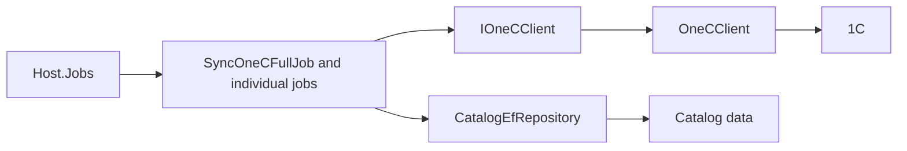

# 1C catalog import

**Static code check:** 2026-10-16. **Module:** Catalog.

Background import of categories, product details, prices, price types, and stock.

## Structure and relationships

[Host.Jobs](../../../../src/Bootstrapper/Host.Jobs/Host.Jobs/Program.cs) runs the [full job](../../../../src/Catalog/Catalog.Application/Integrations/OneC/Jobs/SyncOneCFullJob.cs) and individual jobs. The [client contract](../../../../src/Catalog/Catalog.Application/Integrations/OneC/Contracts/IOneCClient.cs) isolates 1C; [OneCClient](../../../../src/Catalog/Catalog.Infrastructure/Integrations/OneC/Client/OneCClient.cs) implements access; [CatalogEfRepository](../../../../src/Catalog/Catalog.Infrastructure/Repositories/CatalogEfRepository.cs) persists data.

## Code structure

The tree lists verified entry points and key components, not every supporting file.

```text
src/
├── Bootstrapper/Host.Jobs/Host.Jobs/Program.cs  # runs the job
└── Catalog/
    ├── Catalog.Application/Integrations/OneC/
    │   ├── Contracts/IOneCClient.cs  # port and contract
    │   └── Jobs/SyncOneCFullJob.cs  # background job
    └── Catalog.Infrastructure/
        ├── Integrations/OneC/Client/OneCClient.cs  # infrastructure implementation
        └── Repositories/CatalogEfRepository.cs  # data access
```

## Structure diagram



## Tests

[CosmosProductMappingTests.cs](../../../../tests/UnitTests/Catalog/Application/CosmosProductMappingTests.cs)

The import job and 1C client have no dedicated automated tests.

Focused run: `dotnet test tests/UnitTests/UnitTests.csproj --filter "FullyQualifiedName~CosmosProductMapping"`.

## Related sources

[CLI](../../operations/jobs/host-jobs-cli.md) · [Import flow](../../architecture/integrations/one-c/catalog-import-flow.md) · [Root SDD](../../specs/catalog/cosmos-one-c-root/README.md).
