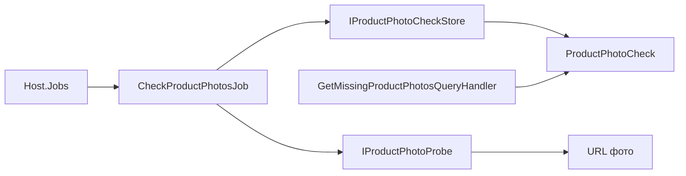

# Перевірка фото товарів

**Статична звірка з кодом:** 2026-10-16. **Модуль:** Catalog.

Окрема job `check-product-photos` перевіряє доступність основних фото товарів; admin API читає її результати для списку проблемних фото.

## Будова й зв'язки

[Host.Jobs](../../../../src/Bootstrapper/Host.Jobs/Host.Jobs/Program.cs) запускає [CheckProductPhotosJob](../../../../src/Catalog/Catalog.Application/Jobs/ProductPhotos/CheckProductPhotosJob.cs). Вона бере товари партіями через [ProductPhotoCheckStore](../../../../src/Catalog/Catalog.Infrastructure/Products/ProductPhotoCheckStore.cs), перевіряє URL через [ProductPhotoProbe](../../../../src/Catalog/Catalog.Infrastructure/Integrations/ProductPhotos/ProductPhotoProbe.cs) та зберігає [ProductPhotoCheck](../../../../src/Catalog/Catalog.Domain/Entities/ProductPhotoCheck.cs). [GetMissingProductPhotosQueryHandler](../../../../src/Catalog/Catalog.Application/Features/Products/GetMissingPhotos/GetMissingProductPhotosQueryHandler.cs) використовує результати, але не виконує перевірку URL під час HTTP-запиту.

## Структура в коді

Наведено перевірені точки входу та ключові складові фічі; дерево не перелічує всі допоміжні файли.

```text
src/
├── Bootstrapper/Host.Jobs/Host.Jobs/Program.cs  # запуск job
└── Catalog/
    ├── Catalog.Application/
    │   ├── Features/Products/GetMissingPhotos/GetMissingProductPhotosQueryHandler.cs  # обробник сценарію
    │   └── Jobs/ProductPhotos/CheckProductPhotosJob.cs  # фонова задача
    ├── Catalog.Domain/Entities/ProductPhotoCheck.cs  # доменна модель
    └── Catalog.Infrastructure/
        ├── Integrations/ProductPhotos/ProductPhotoProbe.cs  # інфраструктурна реалізація
        └── Products/ProductPhotoCheckStore.cs  # доступ до даних
```

## Схема будови



## Пов'язані джерела

[SDD](../../specs/catalog/003-missing-product-photos/README.md) · [Runbook](../../operations/jobs/catalog-photo-check-runbook.md) · [OpenAPI читання](../../contracts/catalog/products.openapi.yaml).
