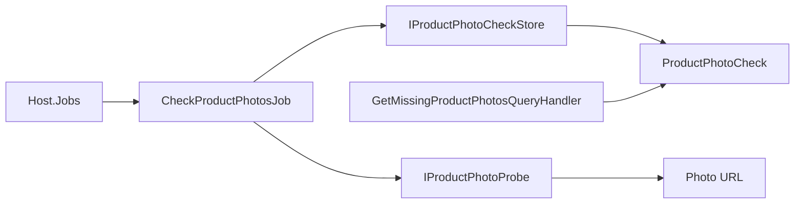

# Product photo check

**Static code check:** 2026-10-16. **Module:** Catalog.

The separate `check-product-photos` job checks whether primary product photos are reachable; the Admin API reads its results for the list of problematic photos.

## Structure and relationships

[Host.Jobs](../../../../src/Bootstrapper/Host.Jobs/Host.Jobs/Program.cs) runs [CheckProductPhotosJob](../../../../src/Catalog/Catalog.Application/Jobs/ProductPhotos/CheckProductPhotosJob.cs). It loads products in batches through [ProductPhotoCheckStore](../../../../src/Catalog/Catalog.Infrastructure/Products/ProductPhotoCheckStore.cs), probes URLs with [ProductPhotoProbe](../../../../src/Catalog/Catalog.Infrastructure/Integrations/ProductPhotos/ProductPhotoProbe.cs), and saves [ProductPhotoCheck](../../../../src/Catalog/Catalog.Domain/Entities/ProductPhotoCheck.cs). [GetMissingProductPhotosQueryHandler](../../../../src/Catalog/Catalog.Application/Features/Products/GetMissingPhotos/GetMissingProductPhotosQueryHandler.cs) uses the saved results; it does not probe URLs during HTTP requests.

## Code structure

The tree lists verified entry points and key components, not every supporting file.

```text
src/
├── Bootstrapper/Host.Jobs/Host.Jobs/Program.cs  # runs the job
└── Catalog/
    ├── Catalog.Application/
    │   ├── Features/Products/GetMissingPhotos/GetMissingProductPhotosQueryHandler.cs  # use-case handler
    │   └── Jobs/ProductPhotos/CheckProductPhotosJob.cs  # background job
    ├── Catalog.Domain/Entities/ProductPhotoCheck.cs  # domain model
    └── Catalog.Infrastructure/
        ├── Integrations/ProductPhotos/ProductPhotoProbe.cs  # infrastructure implementation
        └── Products/ProductPhotoCheckStore.cs  # data access
```

## Structure diagram



## Tests

[ProductPhotoCheckTests.cs](../../../../tests/UnitTests/Catalog/Domain/ProductPhotoCheckTests.cs) · [ProductPhotoCheckJobTests.cs](../../../../tests/UnitTests/Catalog/Application/ProductPhotoCheckJobTests.cs) · [ProductPhotoProbeTests.cs](../../../../tests/IntegrationTests/Catalog/ProductPhotos/ProductPhotoProbeTests.cs) · [ProductPhotoCheckStoreTests.cs](../../../../tests/IntegrationTests/Catalog/ProductPhotos/ProductPhotoCheckStoreTests.cs) · [ProductPhotoCheckStorePostgresTests.cs](../../../../tests/IntegrationTests/Catalog/ProductPhotos/ProductPhotoCheckStorePostgresTests.cs) · [ProductPhotoCheckPersistenceTests.cs](../../../../tests/IntegrationTests/Catalog/Persistence/ProductPhotoCheckPersistenceTests.cs) · [ProductPhotoCheckDeploymentTests.cs](../../../../tests/IntegrationTests/Platform/Jobs/ProductPhotoCheckDeploymentTests.cs)

Focused run: `dotnet test tests/UnitTests/UnitTests.csproj --filter "FullyQualifiedName~ProductPhotoCheck"` and `dotnet test tests/IntegrationTests/IntegrationTests.csproj --filter "FullyQualifiedName~ProductPhotoCheck"`.

## Related sources

[SDD](../../specs/catalog/003-missing-product-photos/README.md) · [Runbook](../../operations/jobs/catalog-photo-check-runbook.md) · [Read OpenAPI](../../contracts/catalog/products.openapi.yaml).
