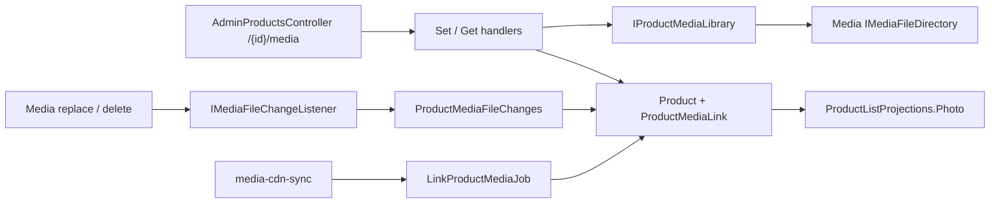

# Product photos and schemes

**Static code check:** 2026-11-04. **Modules:** Catalog (links), Media (files).

A product has 0–20 photos in order and 0–1 scheme, linked by ID to files of the [media library](../media/media-library.md). The 1C import never writes photo URLs. Specification: [Media 001, stage 3](../../specs/media/001-media-library/stage-3-product-media.md).

## Structure and relationships

The links are owned by the [Product](../../../../src/Catalog/Catalog.Domain/Entities/Product.Media.cs) aggregate as [ProductMediaLink](../../../../src/Catalog/Catalog.Domain/Entities/ProductMediaLink.cs) rows (table `ProductMedia`: product, media file ID, kind, position, URL copy). `Product.Photo` and `Product.Sсheme` stay as a cache of the first photo and the scheme, so lists, sales, and projections remain one-table reads; they are an empty string without media.

Catalog reads files only through its port [IProductMediaLibrary](../../../../src/Catalog/Catalog.Application/Contracts/Media/IProductMediaLibrary.cs). Catalog.Infrastructure serves it with the Media contract [IMediaFileDirectory](../../../../src/Media/Media.Contracts/Files/IMediaFileDirectory.cs). Media calls every [IMediaFileChangeListener](../../../../src/Media/Media.Contracts/Files/IMediaFileChangeListener.cs) after a replace or delete; the Catalog listener updates the links through [ProductMediaFileChanges](../../../../src/Catalog/Catalog.Application/Features/ProductMedia/FileChanges/ProductMediaFileChanges.cs). A failed listener is logged and does not fail the Media request.

- `GET/PUT /api/admin/products/{id}/media` (CanManageProducts + CanManageMedia): read or replace the whole set. Unknown file IDs are `400`.
- `GET /api/admin/products?withoutPhoto=true`: products whose cached photo is empty.
- Public product details return `photo`, `scheme`, and `photos` (gallery order).
- The [link job](../../../../src/Catalog/Catalog.Application/Jobs/ProductMedia/LinkProductMediaJob.cs) runs inside `--job=media-cdn-sync` after the sync, with the same `--dry-run`. It rereads link URLs, drops links to deleted files, rewrites the cache, and links `products/<id>.<jpg|jpeg|png|webp>` and `product-scheme/s<id>.<ext>` to active products without links of that kind. See the [runbook](../../operations/jobs/media-cdn-sync-runbook.md).

Every change copies the cached photo into `ProductListProjections` with one SQL update (`RefreshPhotosAsync`).

## Code structure

```text
src/
├── Media/Media.Contracts/Files/                 # contract for other modules
│   ├── IMediaFileDirectory.cs                   # files by ID and by CDN directory
│   ├── IMediaFileChangeListener.cs              # replace and delete callbacks
│   └── MediaFileReference.cs
├── Media/Media.Infrastructure/Files/MediaFileDirectory.cs
├── Media/Media.Application/Features/Files/Common/MediaFileChangeNotifier.cs
└── Catalog/
    ├── Catalog.Domain/Entities/{Product.Media,ProductMediaLink}.cs  # links, rules R-30, cache
    ├── Catalog.Application/
    │   ├── Contracts/Media/IProductMediaLibrary.cs             # Catalog port
    │   ├── Features/ProductMedia/{Get,Set,FileChanges,Common}/ # endpoints, listener use case
    │   └── Jobs/ProductMedia/LinkProductMediaJob.cs            # auto-link and cache refresh
    ├── Catalog.Infrastructure/MediaLibrary/                    # port adapter and listener
    └── Catalog.Api/Controllers/AdminProductsController.cs      # /{id}/media
```

## Structure diagram



## Tests

[ProductMediaTests.cs](../../../../tests/UnitTests/Catalog/Domain/ProductMediaTests.cs) · [SetProductMediaCommandValidatorTests.cs](../../../../tests/UnitTests/Catalog/Application/SetProductMediaCommandValidatorTests.cs) · [ProductMediaApiTests.cs](../../../../tests/IntegrationTests/Catalog/ProductMedia/ProductMediaApiTests.cs) · [ProductMediaLinkPostgresTests.cs](../../../../tests/IntegrationTests/Catalog/ProductMedia/ProductMediaLinkPostgresTests.cs) · [ProductImportSoftDeleteTests.cs](../../../../tests/IntegrationTests/Catalog/Import/ProductImportSoftDeleteTests.cs)

Focused run: `dotnet test tests/UnitTests/UnitTests.csproj --filter "FullyQualifiedName~ProductMedia"` and `dotnet test tests/IntegrationTests/IntegrationTests.csproj --filter "FullyQualifiedName~ProductMedia"` (the PostgreSQL tests need Docker).

## Related sources

[Contract](../../contracts/catalog/products.openapi.yaml) · [Data](../../architecture/data-model/catalog-products.md) · [Media library](../media/media-library.md).
