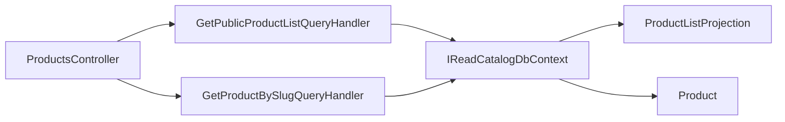

# Публічні товари

**Статична звірка з кодом:** 2026-10-16. **Модуль:** catalog.

Анонімні списки за мовою/категорією та деталі за slug.

## Будова й зв'язки

[ProductsController](../../../../src/Catalog/Catalog.Api/Controllers/ProductsController.cs) викликає [handler списку](../../../../src/Catalog/Catalog.Application/Features/Products/GetPublicList/GetPublicProductListQueryHandler.cs) і [handler деталей](../../../../src/Catalog/Catalog.Application/Features/Products/GetBySlug/GetProductBySlugQueryHandler.cs). Список спирається на [read-проєкцію](../../../../src/Catalog/Catalog.Domain/Entities/ProductListProjection.cs); джерельний товар — [Product](../../../../src/Catalog/Catalog.Domain/Entities/Product.cs), доступ до БД — [IReadCatalogDbContext](../../../../src/Catalog/Catalog.Application/Contracts/Persistence/ICatalogDbContext.cs).

## Структура в коді

Наведено перевірені точки входу та ключові складові фічі; дерево не перелічує всі допоміжні файли.

```text
src/
└── Catalog/
    ├── Catalog.Api/Controllers/ProductsController.cs  # HTTP-вхід
    ├── Catalog.Application/
    │   ├── Contracts/Persistence/ICatalogDbContext.cs  # порт і контракт
    │   └── Features/Products/
    │       ├── GetBySlug/GetProductBySlugQueryHandler.cs  # обробник сценарію
    │       └── GetPublicList/GetPublicProductListQueryHandler.cs  # обробник сценарію
    └── Catalog.Domain/Entities/
        ├── Product.cs  # доменна модель
        └── ProductListProjection.cs  # доменна модель
```

## Схема будови



## Пов'язані джерела

[Контракт](../../contracts/catalog/products.openapi.yaml) · [Проєкція](stock-projection.md).
