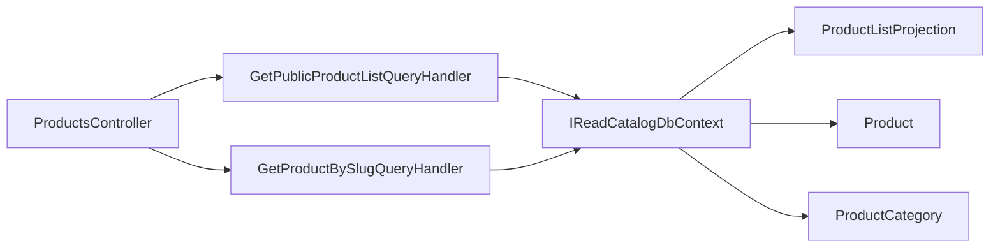

# Public products

**Static code check:** 2026-10-19. **Module:** Catalog.

Anonymous product lists by language/category and details by slug.

## Structure and relationships

[ProductsController](../../../../src/Catalog/Catalog.Api/Controllers/ProductsController.cs) calls the [list handler](../../../../src/Catalog/Catalog.Application/Features/Products/GetPublicList/GetPublicProductListQueryHandler.cs) and [details handler](../../../../src/Catalog/Catalog.Application/Features/Products/GetBySlug/GetProductBySlugQueryHandler.cs). The list uses the [read projection](../../../../src/Catalog/Catalog.Domain/Entities/ProductListProjection.cs); the source product is [Product](../../../../src/Catalog/Catalog.Domain/Entities/Product.cs), the hierarchy is [ProductCategory](../../../../src/Catalog/Catalog.Domain/Entities/ProductCategory.cs), and database access uses [IReadCatalogDbContext](../../../../src/Catalog/Catalog.Application/Contracts/Persistence/ICatalogDbContext.cs).

When `categoryId` or `categorySlug` is supplied, the handler reads existing categories, chooses a root by ID (which takes precedence) or slug, then traverses all descendants by `ParentId` with no fixed depth. Public projections are filtered by the subtree ID set before counting, sorting, and paging. An unknown category returns an empty page; without a category parameter, the general list is retained.

## Code structure

The tree lists verified entry points and key feature components; it does not include every supporting file.

```text
src/
└── Catalog/
    ├── Catalog.Api/Controllers/ProductsController.cs  # HTTP entry point
    ├── Catalog.Application/
    │   ├── Contracts/Persistence/ICatalogDbContext.cs  # port and contract
    │   └── Features/Products/
    │       ├── GetBySlug/GetProductBySlugQueryHandler.cs  # use-case handler
    │       └── GetPublicList/GetPublicProductListQueryHandler.cs  # use-case handler
    └── Catalog.Domain/Entities/
        ├── Product.cs  # domain model
        ├── ProductCategory.cs  # category hierarchy
        └── ProductListProjection.cs  # list model
```

## Structure diagram



## Related sources

[Contract](../../contracts/catalog/products.openapi.yaml) · [Projection](stock-projection.md) · [Category subtree SDD](../../specs/catalog/002-category-read-api/requirements/public-product-category-filter.md).
