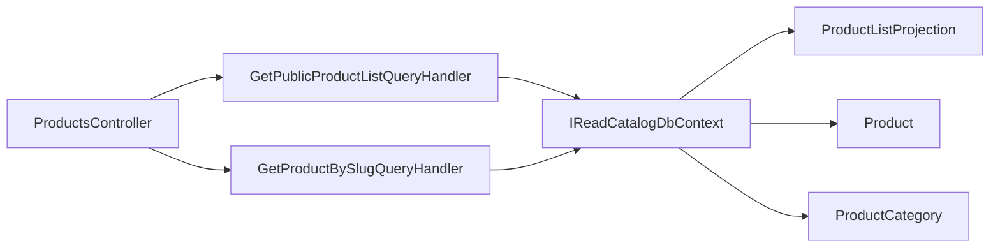

# Public products

**Static code check:** 2026-10-30. **Module:** Catalog.

Anonymous product lists by language/category and details by slug.

## Structure and relationships

[ProductsController](../../../../src/Catalog/Catalog.Api/Controllers/ProductsController.cs) calls the [list handler](../../../../src/Catalog/Catalog.Application/Features/Products/GetPublicList/GetPublicProductListQueryHandler.cs) and [details handler](../../../../src/Catalog/Catalog.Application/Features/Products/GetBySlug/GetProductBySlugQueryHandler.cs). The list uses the [read projection](../../../../src/Catalog/Catalog.Domain/Entities/ProductListProjection.cs); the source product is [Product](../../../../src/Catalog/Catalog.Domain/Entities/Product.cs), the hierarchy is [ProductCategory](../../../../src/Catalog/Catalog.Domain/Entities/ProductCategory.cs), and database access uses [IReadCatalogDbContext](../../../../src/Catalog/Catalog.Application/Contracts/Persistence/ICatalogDbContext.cs).

When `categoryId` or `categorySlug` is supplied, the handler reads existing categories, chooses a root by ID (which takes precedence) or slug, then traverses all descendants by `ParentId` with no fixed depth. Public projections are filtered by the subtree ID set before counting, sorting, and paging. A former category slug resolves through [SlugService](../../../../src/Catalog/Catalog.Application/Slugs/SlugService.cs); an unknown or deleted category slug returns `404`, an unknown `categoryId` an empty page; without a category parameter, the general list is retained. `availability` (`InStock` or `All`) overrides `inStock` when supplied, and the `AvailabilityThenName` sort lists in-stock products first.

Details resolve a current or former slug; the response carries the current `productSlug` and `updatedAt`. A deleted product returns `404` with a [CatalogRedirect](../../../../src/Catalog/Catalog.Contracts/Category/CatalogRedirect.cs) body naming its active category. Deleted products and products of deleted categories never appear: the projection leaves them out and the details query filters them.

## Code structure

The tree lists verified entry points and key feature components; it does not include every supporting file.

```text
src/
└── Catalog/
    ├── Catalog.Api/Controllers/ProductsController.cs  # HTTP entry point
    ├── Catalog.Application/
    │   ├── Contracts/Persistence/ICatalogDbContext.cs  # port and contract
    │   └── Features/Products/
    │       ├── GetBySlug/GetProductBySlugQueryHandler.cs  # use-case handler
    │       └── GetPublicList/GetPublicProductListQueryHandler.cs  # use-case handler
    └── Catalog.Domain/Entities/
        ├── Product.cs  # domain model
        ├── ProductCategory.cs  # category hierarchy
        └── ProductListProjection.cs  # list model
```

## Structure diagram



## Tests

[PublicProductCategoryFilterTests.cs](../../../../tests/IntegrationTests/Catalog/Persistence/PublicProductCategoryFilterTests.cs) · [CatalogStableUrlsApiTests.cs](../../../../tests/IntegrationTests/Catalog/Api/CatalogStableUrlsApiTests.cs) · [ApiContractTests.cs](../../../../tests/IntegrationTests/Platform/Api/ApiContractTests.cs)

Focused run: `dotnet test tests/IntegrationTests/IntegrationTests.csproj --filter "FullyQualifiedName~PublicProductCategoryFilter|FullyQualifiedName~CatalogStableUrlsApiTests"`.

## Related sources

[Contract](../../contracts/catalog/products.openapi.yaml) · [Projection](stock-projection.md) · [Category subtree SDD](../../specs/catalog/002-category-read-api/requirements/public-product-category-filter.md) · [Stable URLs SDD](../../specs/catalog/005-stable-urls-and-category-content/README.md).
