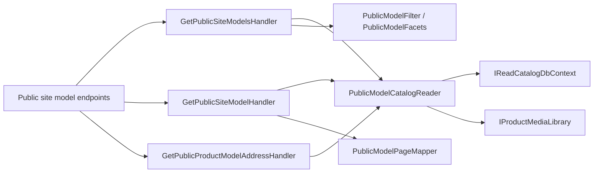

# Public site models

**Static code check:** 2026-11-05 (spec 007 stage 5). **Module:** Catalog.

Anonymous reads the new public site is built from: model cards of a category with attribute filters, the search, the model page, and the model address of an old product address. Decisions and scenarios are in [spec 007](../../specs/catalog/007-site-models/README.md) (M-04, M-09–M-12).

## Structure and relationships

[SiteModels endpoints](../../../../src/Modules/Catalog/Catalog.Api/Endpoints/SiteModels/SiteModelsEndpoints.cs) (route `api/catalog/{lang}`, anonymous) sends four queries. Each reads [PublicModelCatalog](../../../../src/Modules/Catalog/Catalog.Application/Features/SiteModels/Shared/Public/PublicModelCatalog.cs) through [PublicModelCatalogReader](../../../../src/Modules/Catalog/Catalog.Application/Features/SiteModels/Shared/Public/PublicModelCatalogReader.cs) once per request: on-site products of public categories from the [list projection](../../../../src/Modules/Catalog/Catalog.Domain/Products/ProductListProjection.cs) (Cosmos and its subtree stay out), accepted models with their on-site products, saved axes and texts, confirmed attribute values, the shared dictionary with swatch textures from the media library, and the category filters. An on-site product outside an accepted model becomes a model of its own under its product slug (M-04); an accepted model keeps its slug when the two collide.

- `GET {categorySlug}/models` and `GET models` — [list handler](../../../../src/Modules/Catalog/Catalog.Application/Features/SiteModels/Queries/GetPublicSiteModels/GetPublicSiteModelsHandler.cs): models of the category tree (a former category slug still works) or of every category for the search. [PublicModelFilter](../../../../src/Modules/Catalog/Catalog.Application/Features/SiteModels/Queries/GetPublicSiteModels/PublicModelFilter.cs) keeps a model when one of its products matches the attribute choices and the common filters; attribute filters only in a final category (400 in a parent, 404 for an unknown slug). [PublicModelFacets](../../../../src/Modules/Catalog/Catalog.Application/Features/SiteModels/Queries/GetPublicSiteModels/PublicModelFacets.cs) counts models per value of the category's filters, applying every other choice. The search matches every word in the model name or in one product's names or 1C code; an exact on-site 1C code also gives `exactMatch`.
- `GET model/{modelSlug}` — [model handler](../../../../src/Modules/Catalog/Catalog.Application/Features/SiteModels/Queries/GetPublicSiteModel/GetPublicSiteModelHandler.cs) and [PublicModelPageMapper](../../../../src/Modules/Catalog/Catalog.Application/Features/SiteModels/Shared/Public/PublicModelPageMapper.cs): axes with the values the products have, each product with its axis values (`selection`), texts (Russian falls back to Ukrainian field by field), breadcrumbs, and the shared characteristics. A former model slug or the slug of a product inside an accepted model answers 404 with the address to redirect to.
- `GET product/{productSlug}/model` — [address handler](../../../../src/Modules/Catalog/Catalog.Application/Features/SiteModels/Queries/GetPublicProductModelAddress/GetPublicProductModelAddressHandler.cs): the model and axis values of a current or former product slug (M-11); a product off the site or deleted gives 404 with its category as [CatalogRedirect](../../../../src/Modules/Catalog/Catalog.Contracts/Category/CatalogRedirect.cs).

The product endpoints of [public products](public-products.md) stay for the current Angular site until the Next.js site moves to models (stage 6).

## Code structure

```text
src/Modules/Catalog/
├── Catalog.Api/Endpoints/SiteModels/  # public group: four anonymous GET routes
├── Catalog.Contracts/SiteModels/Public/              # request, list and page DTOs
└── Catalog.Application/Features/SiteModels/Public/
    ├── Common/      # PublicModelCatalog (+ reader, facts records), PublicModelPageMapper
    ├── GetList/     # query, validator, handler, PublicModelFilter, PublicModelFacets
    ├── Get/         # model page query and handler
    └── GetProductAddress/   # old product address → model
```

## Structure diagram



## Tests

[PublicSiteModelTests.cs](../../../../tests/IntegrationTests/Catalog/SiteModels/PublicSiteModelTests.cs) · [PublicSiteModelPostgresTests.cs](../../../../tests/IntegrationTests/Catalog/SiteModels/PublicSiteModelPostgresTests.cs) (real PostgreSQL) · [PublicSiteModelsApiTests.cs](../../../../tests/IntegrationTests/Catalog/Api/PublicSiteModelsApiTests.cs) · [ApiContractTests.cs](../../../../tests/IntegrationTests/Platform/Api/ApiContractTests.cs)

Focused run: `dotnet test tests/IntegrationTests/IntegrationTests.csproj --filter "FullyQualifiedName~PublicSiteModel"`.

## Related sources

[Contract](../../contracts/catalog/public-site-models.openapi.yaml) · [Catalog attributes and admin models](attributes.md) · [Spec 007](../../specs/catalog/007-site-models/README.md).
