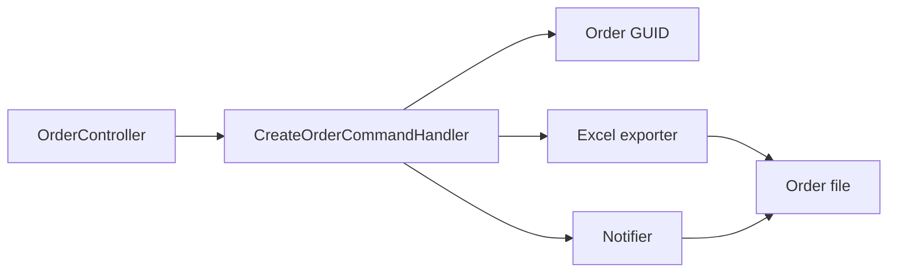

# Quick order

**Static code check:** 2026-10-16. **Module:** Catalog.

Public `POST /api/orders` with Excel generation and Telegram notification.

## Structure and relationships

[OrderController](../../../../src/Catalog/Catalog.Api/Controllers/OrderController.cs) invokes [CreateOrderCommandHandler](../../../../src/Catalog/Catalog.Application/Features/Orders/Create/CreateOrderCommandHandler.cs). The handler creates a GUID, generates an Excel file through an exporter, and sends it with a notifier. This flow does not persist a [Sales Order](../../../../src/Sales/Sales.Domain/Orders/Entities/Order.cs); do not confuse it with Sales admin orders.

## Code structure

The tree lists verified entry points and key components, not every supporting file.

```text
src/
├── Catalog/
│   ├── Catalog.Api/Controllers/OrderController.cs  # HTTP entry point
│   └── Catalog.Application/Features/Orders/Create/CreateOrderCommandHandler.cs  # use-case handler
└── Sales/Sales.Domain/Orders/Entities/Order.cs  # domain model
```

## Structure diagram



## Tests

[ApiContractTests.cs](../../../../tests/IntegrationTests/Platform/Api/ApiContractTests.cs)

No dedicated tests; `ApiContractTests` only checks that the endpoint is in OpenAPI.

## Related sources

[Contract](../../contracts/catalog/orders.openapi.yaml) · [Sales orders](../sales/admin-orders.md).
