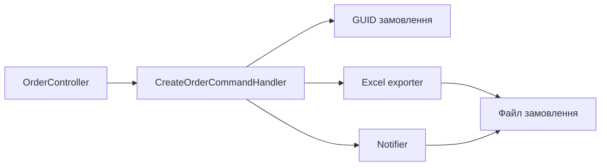

# Швидке замовлення

**Статична звірка з кодом:** 2026-10-16. **Модуль:** catalog.

Публічний `POST /api/orders` із формуванням Excel і сповіщенням Telegram.

## Будова й зв'язки

[OrderController](../../../../src/Catalog/Catalog.Api/Controllers/OrderController.cs) запускає [CreateOrderCommandHandler](../../../../src/Catalog/Catalog.Application/Features/Orders/Create/CreateOrderCommandHandler.cs). Handler створює GUID, формує Excel через exporter і надсилає файл через notifier. Цей потік не зберігає [Sales Order](../../../../src/Sales/Sales.Domain/Orders/Entities/Order.cs); його не слід плутати з admin-замовленнями Sales.

## Структура в коді

Наведено перевірені точки входу та ключові складові фічі; дерево не перелічує всі допоміжні файли.

```text
src/
├── Catalog/
│   ├── Catalog.Api/Controllers/OrderController.cs  # HTTP-вхід
│   └── Catalog.Application/Features/Orders/Create/CreateOrderCommandHandler.cs  # обробник сценарію
└── Sales/Sales.Domain/Orders/Entities/Order.cs  # доменна модель
```

## Схема будови



## Пов'язані джерела

[Контракт](../../contracts/catalog/orders.openapi.yaml) · [Замовлення Sales](../sales/admin-orders.md).
