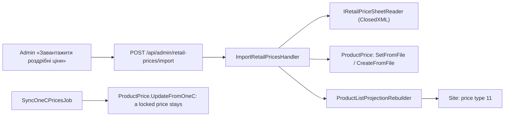

# Retail prices from an Excel file

**Static code check:** 2026-11-26. **Module:** Catalog.

The owner uploads the 1C price list exported to Excel in the Admin; only the site's retail price type («Розница халтмаг 30%», id 11) changes, by product code, and the prices from the file can be kept from the 1C price sync ([spec 010](../../specs/catalog/010-retail-prices-from-file/README.md)).

## Structure and relationships

The [import handler](../../../../src/Modules/Catalog/Catalog.Application/Features/RetailPrices/Commands/ImportRetailPrices/ImportRetailPricesHandler.cs) reads the file through the [sheet port](../../../../src/Modules/Catalog/Catalog.Application/Abstractions/Files/IRetailPriceSheetReader.cs) (implemented with ClosedXML by [ClosedXmlRetailPriceSheetReader](../../../../src/Modules/Catalog/Catalog.Infrastructure/Integrations/Excel/ClosedXmlRetailPriceSheetReader.cs)), applies the [row rules](../../../../src/Modules/Catalog/Catalog.Application/Features/RetailPrices/Commands/ImportRetailPrices/RetailPriceFileRows.cs), changes each [ProductPrice](../../../../src/Modules/Catalog/Catalog.Domain/Products/Prices/ProductPrice.cs) through its root (`SetFromFile`, `CreateFromFile`), saves once, and rebuilds the product list projection. `ProductPrice.LockedFromOneCAt` marks a price the [1C price job](../../../../src/Modules/Catalog/Catalog.Application/Features/OneCSync/Jobs/SyncOneCPricesJob.cs) must not change or remove (`UpdateFromOneC` refuses it). The [unlock handler](../../../../src/Modules/Catalog/Catalog.Application/Features/RetailPrices/Commands/UnlockRetailPrices/UnlockRetailPricesHandler.cs) gives all of them back to 1C. The [status reader](../../../../src/Modules/Catalog/Catalog.Application/Features/RetailPrices/Shared/RetailPriceStatusReader.cs) counts locked prices without loading aggregates. A PostgreSQL `xmin` row version on `ProductPrice` turns a race with the 1C sync into 409 instead of a lost lock.

The site shows the retail type through `Catalog:Pricing:RetailPriceTypeId` = 11 (`appsettings.json` of Host.Api and Host.Jobs), which the [projection rebuilder](../../../../src/Modules/Catalog/Catalog.Infrastructure/Persistence/Products/ProductListProjectionRebuilder.cs) copies into every list row.

## Code structure

```text
src/Modules/Catalog/
├── Catalog.Api/Endpoints/RetailPrices/  # GET status, POST import (multipart), POST unlock; CanManageProducts
├── Catalog.Application/
│   ├── Abstractions/Files/  # IRetailPriceSheetReader and its rows
│   └── Features/RetailPrices/
│       ├── Commands/ImportRetailPrices/  # command, validator, handler, RetailPriceFileRows
│       ├── Commands/UnlockRetailPrices/  # command, handler
│       ├── Queries/GetRetailPriceStatus/  # query, handler
│       └── Shared/  # RetailPriceStatusReader, RetailPriceSave (one save, 409 on a 1C race)
├── Catalog.Contracts/RetailPrices/  # RetailPriceStatusDto, RetailPriceImportResultDto
├── Catalog.Domain/Products/Prices/ProductPrice.cs  # LockedFromOneCAt, SetFromFile, UpdateFromOneC, UnlockFromOneC
└── Catalog.Infrastructure/Integrations/Excel/  # ClosedXML reader and header search
```

## Structure diagram



## Tests

[ProductPriceLockTests](../../../../tests/UnitTests/Catalog/RetailPrices/ProductPriceLockTests.cs), [RetailPriceFileRowsTests](../../../../tests/UnitTests/Catalog/RetailPrices/RetailPriceFileRowsTests.cs), [ImportRetailPricesValidatorTests](../../../../tests/UnitTests/Catalog/RetailPrices/ImportRetailPricesValidatorTests.cs), [ImportRetailPricesTests](../../../../tests/IntegrationTests/Catalog/RetailPrices/ImportRetailPricesTests.cs), [RetailPriceSheetReaderTests](../../../../tests/IntegrationTests/Catalog/RetailPrices/RetailPriceSheetReaderTests.cs), [RetailPricesApiTests](../../../../tests/IntegrationTests/Catalog/RetailPrices/RetailPricesApiTests.cs), and the lock case in [PriceImportTests](../../../../tests/IntegrationTests/Catalog/Import/PriceImportTests.cs) (all without Docker).

Focused run: `dotnet test tests/UnitTests/UnitTests.csproj --filter "FullyQualifiedName~RetailPrices"` and `dotnet test tests/IntegrationTests/IntegrationTests.csproj --filter "FullyQualifiedName~IntegrationTests.Catalog.RetailPrices|FullyQualifiedName~PriceImportTests"`.

## Related sources

[SDD](../../specs/catalog/010-retail-prices-from-file/README.md) · [1C catalog import](one-c-import.md) · [Public products](public-products.md).
