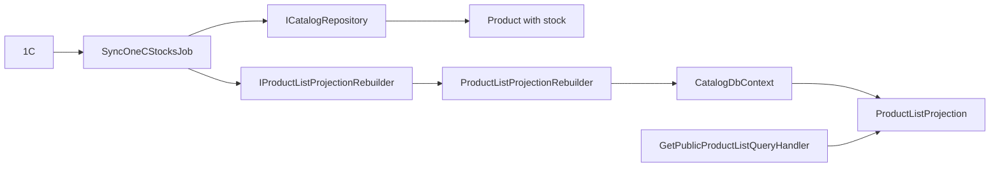

# Product and stock projection

**Static code check:** 2026-10-16. **Module:** Catalog.

A separate read model for product lists and its updates.

## Structure and relationships

[ProductListProjection](../../../../src/Catalog/Catalog.Domain/Entities/ProductListProjection.cs) stores list data in [CatalogDbContext](../../../../src/Catalog/Catalog.Infrastructure/DataBase/CatalogDbContext.cs). The [rebuilder](../../../../src/Catalog/Catalog.Infrastructure/Projections/ProductListProjectionRebuilder.cs) rebuilds the projection; the [stock job](../../../../src/Catalog/Catalog.Application/Integrations/OneC/Jobs/SyncOneCStocksJob.cs) updates stock. The [public handler](../../../../src/Catalog/Catalog.Application/Features/Products/GetPublicList/GetPublicProductListQueryHandler.cs) reads the projection.

## Code structure

The tree lists verified entry points and key components, not every supporting file.

```text
src/
└── Catalog/
    ├── Catalog.Application/
    │   ├── Features/Products/GetPublicList/GetPublicProductListQueryHandler.cs  # use-case handler
    │   └── Integrations/OneC/Jobs/SyncOneCStocksJob.cs  # background job
    ├── Catalog.Domain/Entities/ProductListProjection.cs  # domain model
    └── Catalog.Infrastructure/
        ├── DataBase/CatalogDbContext.cs  # data context
        └── Projections/ProductListProjectionRebuilder.cs  # infrastructure implementation
```

## Structure diagram



## Related sources

[SDD](../../specs/catalog/stock-projection-refresh/README.md) · [Jobs](../../operations/jobs/README.md).
