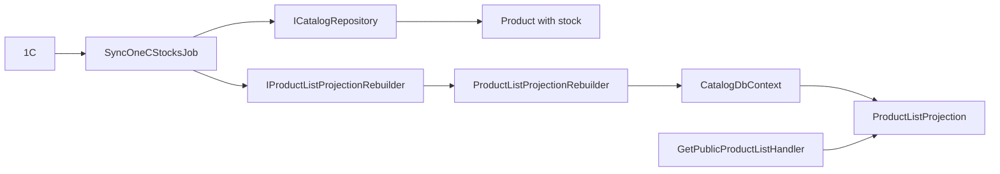

# Product and stock projection

**Static code check:** 2026-10-16. **Module:** Catalog.

A separate read model for product lists and its updates.

## Structure and relationships

[ProductListProjection](../../../../src/Modules/Catalog/Catalog.Application/Features/Products/Shared/ProductListProjection.cs), a read model on the read side of Application (CQRS level 2, [ADR-0015](../../architecture/decisions/0015-product-list-read-table.md)), stores list data in [CatalogDbContext](../../../../src/Modules/Catalog/Catalog.Infrastructure/Persistence/CatalogDbContext.cs). The [rebuilder](../../../../src/Modules/Catalog/Catalog.Infrastructure/Persistence/Products/ProductListProjectionRebuilder.cs) rebuilds the projection; the [stock job](../../../../src/Modules/Catalog/Catalog.Application/Features/OneCSync/Jobs/SyncOneCStocksJob.cs) updates stock. The [public handler](../../../../src/Modules/Catalog/Catalog.Application/Features/Products/Queries/GetPublicProductList/GetPublicProductListHandler.cs) reads the projection.

## Code structure

The tree lists verified entry points and key components, not every supporting file.

```text
src/Modules/Catalog/
├── Catalog.Application/
│   ├── Abstractions/Persistence/IProductListProjectionRebuilder.cs  # rebuild port
│   ├── Features/Products/Shared/ProductListProjection.cs  # read model (not an aggregate)
│   ├── Features/Products/Queries/GetPublicProductList/GetPublicProductListHandler.cs  # reads the projection
│   └── Features/OneCSync/Jobs/SyncOneCStocksJob.cs  # background job, rebuilds after the sync
└── Catalog.Infrastructure/Persistence/
    ├── CatalogDbContext.cs  # data context
    └── Products/ProductListProjectionRebuilder.cs  # rebuild in one transaction
```

## Structure diagram



## Tests

[ProductStockTests.cs](../../../../tests/UnitTests/Catalog/Domain/ProductStockTests.cs)

The projection refresh has no dedicated automated tests.

Focused run: `dotnet test tests/UnitTests/UnitTests.csproj --filter "FullyQualifiedName~ProductStock"`.

## Related sources

[SDD](../../specs/catalog/stock-projection-refresh/README.md) · [Jobs](../../operations/jobs/README.md).
