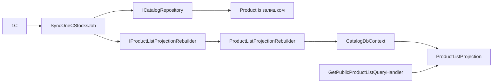

# Проєкція товарів і залишків

**Статична звірка з кодом:** 2026-10-16. **Модуль:** catalog.

Окрема read-модель для списків товарів та її оновлення.

## Будова й зв'язки

[ProductListProjection](../../../../src/Catalog/Catalog.Domain/Entities/ProductListProjection.cs) зберігає дані списку у [CatalogDbContext](../../../../src/Catalog/Catalog.Infrastructure/DataBase/CatalogDbContext.cs). [Rebuilder](../../../../src/Catalog/Catalog.Infrastructure/Projections/ProductListProjectionRebuilder.cs) перебудовує проєкцію; [stock job](../../../../src/Catalog/Catalog.Application/Integrations/OneC/Jobs/SyncOneCStocksJob.cs) оновлює залишки. [Публічний handler](../../../../src/Catalog/Catalog.Application/Features/Products/GetPublicList/GetPublicProductListQueryHandler.cs) читає проєкцію.

## Структура в коді

Наведено перевірені точки входу та ключові складові фічі; дерево не перелічує всі допоміжні файли.

```text
src/
└── Catalog/
    ├── Catalog.Application/
    │   ├── Features/Products/GetPublicList/GetPublicProductListQueryHandler.cs  # обробник сценарію
    │   └── Integrations/OneC/Jobs/SyncOneCStocksJob.cs  # фонова задача
    ├── Catalog.Domain/Entities/ProductListProjection.cs  # доменна модель
    └── Catalog.Infrastructure/
        ├── DataBase/CatalogDbContext.cs  # контекст даних
        └── Projections/ProductListProjectionRebuilder.cs  # інфраструктурна реалізація
```

## Схема будови



## Пов'язані джерела

[SDD](../../specs/catalog/stock-projection-refresh/README.md) · [Jobs](../../operations/jobs/README.md).
