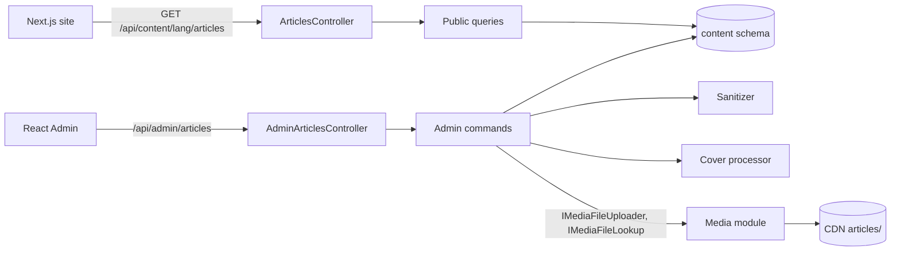

# Site articles

**Static code check:** 2026-11-04. **Module:** Content.

Articles of the public site in Ukrainian and Russian: the site reads published ones, Managers and Admins write them in the admin. The six articles the site kept in code were moved into the database with their ids, slugs, and covers.

## Structure and relationships

The [public controller](../../../../src/Content/Content.Api/Controllers/ArticlesController.cs) and [admin controller](../../../../src/Content/Content.Api/Controllers/AdminArticlesController.cs) dispatch to Application handlers. [Article](../../../../src/Content/Content.Domain/Articles/Article.cs) holds one slug, the publication date and flag, the cover (`CoverMediaFileId`, a media-library file by value), and exactly one [translation](../../../../src/Content/Content.Domain/Articles/ArticleTranslation.cs) per language (title, excerpt, sanitized body). The cover is uploaded before the article is saved (`POST /api/admin/articles/covers`), so a new article gets it in its first save: the [upload handler](../../../../src/Content/Content.Application/Features/Articles/Admin/UploadCover/UploadArticleCoverCommandHandler.cs) puts the WebP into the media library through [IMediaImageWriter](../../../../src/Content/Content.Application/Contracts/MediaLibrary/IMediaImageWriter.cs) → `Media.Contracts.IMediaFileUploader` (CDN `articles/`, library folder «Статті»), and create/update take `coverMediaFileId` or `removeCover` ([ArticleCovers](../../../../src/Content/Content.Application/Features/Articles/Common/ArticleCovers.cs)). Responses carry the CDN `coverUrl`. The six legacy covers are still bytes in [ArticleCover](../../../../src/Content/Content.Domain/Articles/ArticleCover.cs), served with a versioned `coverPath`, until an editor picks a new cover or presses the list's move action (`POST /api/admin/articles/covers/move-legacy`, [handler](../../../../src/Content/Content.Application/Features/Articles/Admin/MoveLegacyCovers/MoveLegacyArticleCoversCommandHandler.cs)) ([Content 008](../../specs/content/008-article-cover-cdn/README.md)).

On save the body passes the [article sanitizer](../../../../src/Content/Content.Infrastructure/Html/ArticleHtmlSanitizer.cs); an uploaded cover goes through the [cover processor](../../../../src/Content/Content.Infrastructure/Images/CoverImageProcessor.cs) (JPEG/PNG/WebP up to 10 MB, at least 600 px wide, stored as WebP at most 1600 px wide with EXIF orientation applied). Without a slug, create builds one from the Ukrainian title with the shared [KMU-2010 transliterator](../../../../src/BuildingBlocks/BuildingBlocks.Application/Text/UkrainianTransliterator.cs) and adds `-2`, `-3`… on a clash.

Every save (create, update, including the cover) stores `UpdatedBy`, the editor's email from the session ([ContentEditor](../../../../src/Content/Content.Application/Features/Editing/ContentEditor.cs)); admin responses return it, public ones never do.

Access: public reads are anonymous; `/api/admin/articles` needs `CanManageContent` (Manager or Admin).

## Code structure

```text
src/
├── Content/
│   ├── Content.Api/
│   │   ├── Controllers/ArticlesController.cs       # public HTTP: list, by slug, cover bytes
│   │   ├── Controllers/AdminArticlesController.cs  # admin HTTP: CRUD and cover upload
│   │   └── Articles/                               # response/request records, coverUrl/coverPath mapping
│   ├── Content.Application/
│   │   ├── Contracts/                              # repository, read context, sanitizer, cover processor, media library ports
│   │   └── Features/Articles/
│   │       ├── Common/                             # DTOs, input validator base, slug builder, cover rules, specs
│   │       ├── Public/{GetList,GetBySlug,GetCover}/
│   │       └── Admin/{GetList,GetById,Create,Update,Delete,UploadCover}/
│   ├── Content.Domain/Articles/                    # Article, ArticleTranslation, ArticleCover, errors
│   └── Content.Infrastructure/
│       ├── DataBase/ContentDbContext.cs            # schema `content`, own migration history
│       ├── Configurations/                         # Articles, ArticleTranslations, ArticleCovers
│       ├── Html/ArticleHtmlSanitizer.cs
│       ├── Images/CoverImageProcessor.cs
│       ├── MediaLibrary/                           # reader and writer over Media.Contracts
│       ├── Seed/                                   # the six legacy articles and their WebP covers
│       └── Migrations/                             # InitialContent, SeedLegacyArticles, …, AddArticleCoverMediaFile
└── BuildingBlocks/BuildingBlocks.Application/Text/UkrainianTransliterator.cs  # shared with Catalog slugs
```

## Structure diagram



## Data

Tables `content."Articles"`, `content."ArticleTranslations"`, `content."ArticleCovers"`; see the [database map](../../architecture/data-model/content-articles.md).

## Tests

- Unit: [ArticleTests](../../../../tests/UnitTests/Content/ArticleTests.cs) — `dotnet test tests/UnitTests/UnitTests.csproj --filter "FullyQualifiedName~UnitTests.Content"`.
- Integration: [infrastructure](../../../../tests/IntegrationTests/Content/ContentInfrastructureTests.cs), [HTTP and access](../../../../tests/IntegrationTests/Content/ArticlesApiTests.cs), [PostgreSQL migrations and handlers](../../../../tests/IntegrationTests/Content/ArticlesPostgresTests.cs) — `dotnet test tests/IntegrationTests/IntegrationTests.csproj --filter "FullyQualifiedName~IntegrationTests.Content"` (the PostgreSQL part needs Docker or `KEDR_CONTENT_TEST_POSTGRES_CONNECTION`).

## Related sources

- [Specification](../../specs/content/001-articles/README.md), [cover on the CDN](../../specs/content/008-article-cover-cdn/README.md)
- [Contract](../../contracts/content/articles.openapi.yaml)
