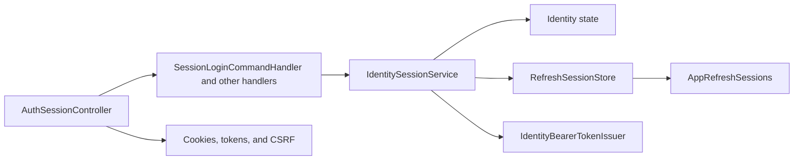

# User session

**Static code check:** 2026-10-28. **Module:** Identity.

Login, refresh, logout, and current-user operations.

## Structure and relationships

[AuthSessionController](../../../../src/Identity/Identity.Api/Identity.Api/Controllers/AuthSessionController.cs) calls the [login handler](../../../../src/Identity/Identity.Application/Features/Auth/SessionLogin/SessionLoginCommandHandler.cs) and handlers for other operations. [IdentitySessionService](../../../../src/Identity/Identity.Infrastructure/Services/IdentitySessionService.cs) runs the use cases; [RefreshSessionStore](../../../../src/Identity/Identity.Infrastructure/Services/RefreshSessionStore.cs) creates, rotates and revokes refresh sessions; [IdentityBearerTokenIssuer](../../../../src/Identity/Identity.Infrastructure/Services/IdentityBearerTokenIssuer.cs) issues bearer tokens. Token, cookie, and CSRF rules are described in the separate [session flow](../../architecture/security/authentication/session-flow.md).

## Code structure

The tree lists verified entry points and key components, not every supporting file.

```text
src/
└── Identity/
    ├── Identity.Api/Identity.Api/Controllers/AuthSessionController.cs  # HTTP entry point
    ├── Identity.Application/Features/Auth/
    │   ├── SessionLogin/SessionLoginCommandHandler.cs  # use-case handler
    │   ├── SessionLogout/SessionLogoutCommandHandler.cs  # use-case handler
    │   ├── SessionMe/SessionMeQueryHandler.cs  # use-case handler
    │   └── SessionRefresh/SessionRefreshCommandHandler.cs  # use-case handler
    └── Identity.Infrastructure/Services/
        ├── IdentitySessionService.cs  # login, refresh, logout, me
        ├── RefreshSessionStore.cs  # refresh-session rows, rotation with xmin check
        └── IdentityBearerTokenIssuer.cs  # bearer token issue
```

## Structure diagram



## Tests

PostgreSQL integration tests in [Identity/Sessions](../../../../tests/IntegrationTests/Identity/Sessions/) cover lockout, Data Protection keys, the refresh grace window, parallel refresh and logout scope. They need Docker or `KEDR_IDENTITY_TEST_POSTGRES_CONNECTION`.

`dotnet test tests/IntegrationTests/IntegrationTests.csproj --filter "FullyQualifiedName~IntegrationTests.Identity"`

## Related sources

[Contract](../../contracts/identity/session.openapi.yaml) · [Provisioning](../../architecture/security/users/provisioning-and-registration.md).
