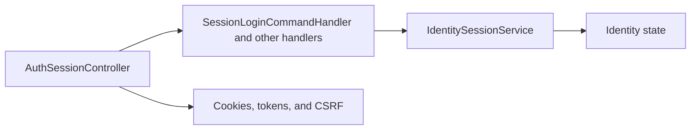

# User session

**Static code check:** 2026-10-16. **Module:** Identity.

Login, refresh, logout, and current-user operations.

## Structure and relationships

[AuthSessionController](../../../../src/Identity/Identity.Api/Identity.Api/Controllers/AuthSessionController.cs) calls the [login handler](../../../../src/Identity/Identity.Application/Features/Auth/SessionLogin/SessionLoginCommandHandler.cs) and handlers for other operations. [IdentitySessionService](../../../../src/Identity/Identity.Infrastructure/Services/IdentitySessionService.cs) works with Identity state. Token, cookie, and CSRF rules are described in the separate [session flow](../../architecture/security/authentication/session-flow.md).

## Code structure

The tree lists verified entry points and key components, not every supporting file.

```text
src/
└── Identity/
    ├── Identity.Api/Identity.Api/Controllers/AuthSessionController.cs  # HTTP entry point
    ├── Identity.Application/Features/Auth/
    │   ├── SessionLogin/SessionLoginCommandHandler.cs  # use-case handler
    │   ├── SessionLogout/SessionLogoutCommandHandler.cs  # use-case handler
    │   ├── SessionMe/SessionMeQueryHandler.cs  # use-case handler
    │   └── SessionRefresh/SessionRefreshCommandHandler.cs  # use-case handler
    └── Identity.Infrastructure/Services/IdentitySessionService.cs  # infrastructure implementation
```

## Structure diagram



## Tests

No automated tests for login, refresh, logout, or me yet.

## Related sources

[Contract](../../contracts/identity/session.openapi.yaml) · [Provisioning](../../architecture/security/users/provisioning-and-registration.md).
