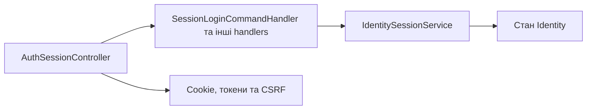

# Сеанс користувача

**Статична звірка з кодом:** 2026-10-16. **Модуль:** identity.

Login, refresh, logout і me.

## Будова й зв'язки

[AuthSessionController](../../../../src/Identity/Identity.Api/Identity.Api/Controllers/AuthSessionController.cs) викликає [login handler](../../../../src/Identity/Identity.Application/Features/Auth/SessionLogin/SessionLoginCommandHandler.cs) та handlers інших операцій; [IdentitySessionService](../../../../src/Identity/Identity.Infrastructure/Services/IdentitySessionService.cs) працює зі станом Identity. Правила токенів, cookie та CSRF описано в окремому [потоці сеансу](../../architecture/security/authentication/session-flow.md).

## Структура в коді

Наведено перевірені точки входу та ключові складові фічі; дерево не перелічує всі допоміжні файли.

```text
src/
└── Identity/
    ├── Identity.Api/Identity.Api/Controllers/AuthSessionController.cs  # HTTP-вхід
    ├── Identity.Application/Features/Auth/
    │   ├── SessionLogin/SessionLoginCommandHandler.cs  # обробник сценарію
    │   ├── SessionLogout/SessionLogoutCommandHandler.cs  # обробник сценарію
    │   ├── SessionMe/SessionMeQueryHandler.cs  # обробник сценарію
    │   └── SessionRefresh/SessionRefreshCommandHandler.cs  # обробник сценарію
    └── Identity.Infrastructure/Services/IdentitySessionService.cs  # інфраструктурна реалізація
```

## Схема будови



## Пов'язані джерела

[Контракт](../../contracts/identity/session.openapi.yaml) · [Provisioning](../../architecture/security/users/provisioning-and-registration.md).
