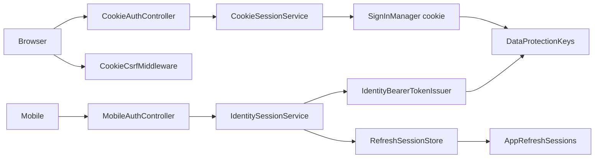

# User session

**Static code check:** 2026-10-28. **Module:** Identity.

Browser cookie login (Admin, storefront), mobile token login and refresh, logout, and the current user. Rules and reasons are in the [session flow](../../architecture/security/authentication/session-flow.md).

## Structure and relationships

[CookieAuthController](../../../../src/Identity/Identity.Api/Identity.Api/Controllers/CookieAuthController.cs) signs a browser in through [CookieSessionService](../../../../src/Identity/Identity.Infrastructure/Services/Sessions/CookieSessionService.cs). [MobileAuthController](../../../../src/Identity/Identity.Api/Identity.Api/Controllers/MobileAuthController.cs) uses [IdentitySessionService](../../../../src/Identity/Identity.Infrastructure/Services/Sessions/IdentitySessionService.cs), which issues tokens with [IdentityBearerTokenIssuer](../../../../src/Identity/Identity.Infrastructure/Services/Sessions/IdentityBearerTokenIssuer.cs) and keeps refresh sessions in [RefreshSessionStore](../../../../src/Identity/Identity.Infrastructure/Services/Sessions/RefreshSessionStore.cs). [AuthSessionController](../../../../src/Identity/Identity.Api/Identity.Api/Controllers/AuthSessionController.cs) serves `me` for both kinds of client. [SessionCookieWriter](../../../../src/Identity/Identity.Api/Identity.Api/Cookies/SessionCookieWriter.cs) owns the CSRF cookie; [CookieCsrfMiddleware](../../../../src/Bootstrapper/Host.Api/Security/Csrf/CookieCsrfMiddleware.cs) checks the CSRF header. The `Kedr` scheme is registered in [IdentityAuthenticationExtensions](../../../../src/Identity/Identity.Infrastructure/DependencyInjection/IdentityAuthenticationExtensions.cs).

## Code structure

```text
src/
├── Identity/
│   ├── Identity.Api/Identity.Api/
│   │   ├── Controllers/
│   │   │   ├── CookieAuthController.cs  # browser login/logout
│   │   │   ├── MobileAuthController.cs  # mobile login/refresh/logout
│   │   │   └── AuthSessionController.cs  # me (current user)
│   │   └── Cookies/SessionCookieWriter.cs  # CSRF and refresh cookies
│   ├── Identity.Application/Features/Auth/
│   │   ├── CookieLogin/, CookieLogout/  # browser use cases
│   │   └── SessionLogin/, SessionRefresh/, SessionLogout/, SessionMe/  # token use cases and me
│   └── Identity.Infrastructure/
│       ├── DependencyInjection/IdentityAuthenticationExtensions.cs  # Kedr policy scheme, cookie, bearer
│       └── Services/Sessions/
│           ├── CookieSessionService.cs  # SignInManager cookie sign-in
│           ├── IdentitySessionService.cs  # token login, refresh, logout, me
│           ├── IdentityBearerTokenIssuer.cs  # access token + random refresh token
│           └── RefreshSessionStore.cs  # refresh-session rows, rotation with xmin check
└── Bootstrapper/Host.Api/Security/Csrf/CookieCsrfMiddleware.cs  # CSRF header for cookie sessions
```

## Structure diagram



## Tests

PostgreSQL integration tests in [Identity/Sessions](../../../../tests/IntegrationTests/Identity/Sessions/) cover lockout, Data Protection keys, the refresh grace window, parallel refresh and logout scope; [Identity/Api](../../../../tests/IntegrationTests/Identity/Api/) covers cookie login, CSRF, and the mobile flow through the real API. They need Docker or `KEDR_IDENTITY_TEST_POSTGRES_CONNECTION`.

`dotnet test tests/IntegrationTests/IntegrationTests.csproj --filter "FullyQualifiedName~IntegrationTests.Identity"`

## Related sources

[Contract](../../contracts/identity/session.openapi.yaml) · [Staff accounts](staff-accounts.md) · [Provisioning](../../architecture/security/users/provisioning-and-registration.md).
