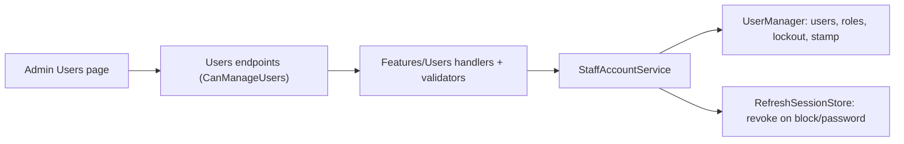

# Staff accounts

**Static code check:** 2026-11-10. **Module:** Identity. **Consumer:** React Admin "Users" page.

An administrator lists administrators and managers (with avatar URLs), creates them with an initial password, changes their role, blocks or unblocks them, and sets a new password for a manager. Name, email and avatar edits of managers are in [staff profile](staff-profile.md). Customers are not staff accounts, but an administrator can find an existing account without staff access (usually a 1C customer whose email is already taken) and give it a staff role, name and password. The first administrator comes from `IdentitySeeder`.

## Structure and relationships

The Minimal API group [UsersEndpoints](../../../../src/Identity/Identity.Api/Endpoints/Users/UsersEndpoints.cs) at `/api/admin/users` (tag `AdminUsers`) requires policy `CanManageUsers` (role Admin); one `<UseCase>Endpoint` per operation dispatches its Application use case. [StaffAccountService](../../../../src/Identity/Identity.Infrastructure/Users/StaffAccountService.cs) implements them with `UserManager`. It refuses to block or re-role the acting administrator, so the system always keeps one. Blocking sets an endless lockout, changes the security stamp (browser sessions end within 5 minutes) and revokes refresh sessions (mobile ends at once). Setting a password does the same through a password reset.

Giving staff access to an existing account (`GET candidates?search=`, `POST {userId}/staff-access`) keeps its email and customer role, sets the name and a new password, clears a lockout and revokes refresh sessions. From then on [ImportedCounterpartyIdentityProvisioningService](../../../../src/Identity/Identity.Infrastructure/Users/ImportedCounterpartyIdentityProvisioningService.cs) leaves a staff account's email, name, password and lockout alone during 1C customer sync, and for a customer removed from 1C it removes only the `User` role instead of deleting the account.

## Code structure

```text
src/Identity/
├── Identity.Api/Endpoints/Users/
│   ├── UsersEndpoints.cs  # HTTP group, CanManageUsers
│   ├── <UseCase>Endpoint.cs  # one per operation
│   └── *Request.cs, *Response.cs  # request and response records
├── Identity.Application/
│   ├── Abstractions/Accounts/IStaffAccountService.cs
│   └── Features/Users/
│       ├── Queries/GetStaffList/, SearchStaffCandidates/
│       ├── Commands/CreateStaff/, ChangeStaffRole/, SetStaffBlocked/, SetStaffPassword/, GrantStaffAccess/  # one use case each
│       └── Shared/  # StaffAccountDto, StaffCandidateDto, StaffRoles, StaffPasswordRules (min 8)
└── Identity.Infrastructure/Users/
    ├── StaffAccountService.cs  # UserManager implementation
    └── ImportedCounterpartyIdentityProvisioningService.cs  # 1C sync; leaves staff accounts alone
```

## Structure diagram



## Tests

Unit: [StaffAccountValidatorsTests](../../../../tests/UnitTests/Identity/Application/StaffAccountValidatorsTests.cs) check staff roles, password length, email and candidate search — `dotnet test tests/UnitTests/UnitTests.csproj --filter "FullyQualifiedName~UnitTests.Identity"`.

[AdminUsersApiTests](../../../../tests/IntegrationTests/Identity/Api/AdminUsersApiTests.cs) run through the real API against PostgreSQL: 401/403, create and duplicate, validation, block and self-block, role and password change, customer search and staff access, 1C sync keeping a staff account.

`dotnet test tests/IntegrationTests/IntegrationTests.csproj --filter "FullyQualifiedName~AdminUsersApiTests"`

## Related sources

[Contract](../../contracts/identity/users.openapi.yaml) · [Authorization](../../architecture/security/authorization/roles-and-policies.md) · [Spec](../../specs/identity/001-authentication-rollout/README.md).
