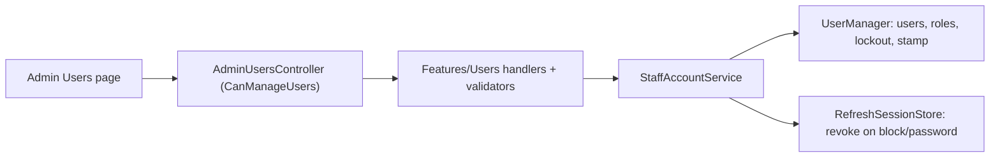

# Staff accounts

**Static code check:** 2026-10-28. **Module:** Identity. **Consumer:** React Admin "Users" page.

An administrator lists administrators and managers, creates them with an initial password, changes their role, blocks or unblocks them, and sets a new password. Customers are not staff accounts. The first administrator comes from `IdentitySeeder`.

## Structure and relationships

[AdminUsersController](../../../../src/Identity/Identity.Api/Identity.Api/Controllers/AdminUsersController.cs) at `/api/admin/users` requires policy `CanManageUsers` (role Admin) and dispatches one Application use case per operation. [StaffAccountService](../../../../src/Identity/Identity.Infrastructure/Services/Users/StaffAccountService.cs) implements them with `UserManager`. It refuses to block or re-role the acting administrator, so the system always keeps one. Blocking sets an endless lockout, changes the security stamp (browser sessions end within 5 minutes) and revokes refresh sessions (mobile ends at once). Setting a password does the same through a password reset.

## Code structure

```text
src/Identity/
├── Identity.Api/Identity.Api/
│   ├── Controllers/AdminUsersController.cs  # HTTP entry, CanManageUsers
│   └── Contracts/Users/  # request and response records
├── Identity.Application/
│   ├── Features/Users/
│   │   ├── GetStaffList/, CreateStaff/, ChangeStaffRole/, SetStaffBlocked/, SetStaffPassword/  # one use case each
│   │   └── Shared/  # StaffAccountDto, StaffRoles, StaffPasswordRules (min 8)
│   └── Services/IStaffAccountService.cs
└── Identity.Infrastructure/Services/Users/StaffAccountService.cs  # UserManager implementation
```

## Structure diagram



## Tests

[AdminUsersApiTests](../../../../tests/IntegrationTests/Identity/Api/AdminUsersApiTests.cs) run through the real API against PostgreSQL: 401/403, create and duplicate, validation, block and self-block, role and password change.

`dotnet test tests/IntegrationTests/IntegrationTests.csproj --filter "FullyQualifiedName~AdminUsersApiTests"`

## Related sources

[Contract](../../contracts/identity/users.openapi.yaml) · [Authorization](../../architecture/security/authorization/roles-and-policies.md) · [Spec](../../specs/identity/001-authentication-rollout/README.md).
