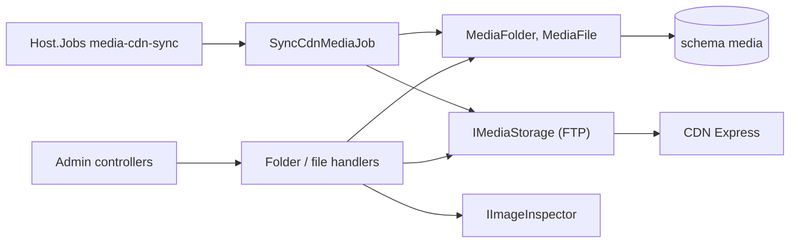

# Media library

**Static code check:** 2026-11-14. **Module:** Media.

The library of pictures on the CDN (`images-kedr.cdn.express`): virtual folders, upload, replace, rename, move, and delete, plus a job that registers the files that already sit on the CDN. Folders live only in the database, so moving anything never changes a CDN URL. Catalog will link product photos and schemes to library files by ID (stage 3 of the [specification](../../specs/media/001-media-library/README.md)).

## Structure and relationships

The Minimal API groups in [FoldersEndpoints](../../../../src/Media/Media.Api/Endpoints/Folders/FoldersEndpoints.cs) and [FilesEndpoints](../../../../src/Media/Media.Api/Endpoints/Files/FilesEndpoints.cs) (`CanManageMedia`, delete also `RequireAdminRole`) have one `<UseCase>Endpoint` per use case that dispatches to its handler; the upload and replace endpoints keep the multipart body limit and rely on the host's cookie CSRF check ([MediaUploads](../../../../src/Media/Media.Api/Endpoints/Files/MediaUploads.cs)). [MediaFolder](../../../../src/Media/Media.Domain/Folders/MediaFolder.cs) is a named node with an optional parent; [MediaFile](../../../../src/Media/Media.Domain/Files/MediaFile.cs) holds the CDN key, display name, type, size, and optional dimensions. Folder checks that need other folders (name clash among siblings, parent exists, no cycle) live in [MediaFolderRules](../../../../src/Media/Media.Application/Features/Folders/Shared/MediaFolderRules.cs).

Uploads go through [MediaUploadStore](../../../../src/Media/Media.Application/Features/Files/Shared/MediaUploadStore.cs): the [image inspector](../../../../src/Media/Media.Infrastructure/Integrations/Images/SkiaImageInspector.cs) reads the real type and size from the picture header, the file is stored unchanged at `library/<yyyy>/<MM>/<guid>.<ext>` through [FtpMediaStorage](../../../../src/Media/Media.Infrastructure/Integrations/Storage/FtpMediaStorage.cs), then the row is saved. Replace keeps the file ID, points it at a new key, and deletes the old CDN file. Without CDN credentials `UnconfiguredMediaStorage` is registered and writes answer `503`.

[SyncCdnMediaJob](../../../../src/Media/Media.Application/Features/Files/Jobs/SyncCdnMedia/SyncCdnMediaJob.cs) (`--job=media-cdn-sync [--dry-run]`) lists the CDN without `avatars/` and dot service directories such as `.thumbs/`, skips known keys, reports unknown files in `library/` as orphans, and registers other pictures: `products` → folder «Товари», `product-scheme` → «Схеми», deeper directories → subfolders. Other modules upload into a CDN directory and a root folder of their own through [IMediaFileUploader](../../../../src/Media/Media.Contracts/Files/IMediaFileUploader.cs) (Content: article covers → `articles/`, «Статті») and arrange files into their own virtual folder tree through [IMediaFolderArranger](../../../../src/Media/Media.Contracts/Folders/IMediaFolderArranger.cs) (Catalog: product photos by category).

Access: everything needs `CanManageMedia` (Manager, Seo, Admin); file and folder delete also need `RequireAdminRole`.

## Code structure

```text
src/Media/
├── Media.Api/
│   ├── Endpoints/Folders/                         # /api/admin/media/folders: FoldersEndpoints, <UseCase>Endpoint, SaveMediaFolderRequest
│   ├── Endpoints/Files/                           # /api/admin/media/files: FilesEndpoints, <UseCase>Endpoint, requests, MediaUploads
│   └── DependencyInjection/MediaModule.cs
├── Media.Application/
│   ├── Abstractions/                               # persistence, storage (CDN, URLs), image inspector ports
│   ├── Features/Folders/{Commands,Queries,Shared}/ # GetMediaFolderTree, CreateMediaFolder, UpdateMediaFolder (rename + move), DeleteMediaFolder
│   ├── Features/Files/{Commands,Queries,Shared}/   # GetMediaFiles, GetMediaFile, UploadMediaFile, ReplaceMediaFile, UpdateMediaFile, MoveMediaFiles, DeleteMediaFile
│   └── Features/Files/Jobs/SyncCdnMedia/           # SyncCdnMediaJob, options, report
├── Media.Contracts/                                # what other modules use: lookup, directory, uploader, folder arranger
├── Media.Domain/                                   # MediaFolder, MediaFile, errors
└── Media.Infrastructure/
    ├── Persistence/MediaDbContext.cs               # schema media, own migration history; {Files,Folders}/ configurations
    ├── Contracts/                                  # Media.Contracts implementations
    ├── Integrations/Storage/                       # FTP storage, URL builder, options
    ├── Integrations/Images/SkiaImageInspector.cs
    ├── DependencyInjection/MediaInfrastructure.cs  # AddMediaInfrastructure
    └── Migrations/*_InitialMedia.cs
```

## Structure diagram



## Data

Tables `media."MediaFolders"` and `media."MediaFiles"`; see the [database map](../../architecture/data-model/media-library.md).

## Tests

- Unit: [MediaDomainTests](../../../../tests/UnitTests/Media/MediaDomainTests.cs) and [MediaValidatorsTests](../../../../tests/UnitTests/Media/MediaValidatorsTests.cs) — `dotnet test tests/UnitTests/UnitTests.csproj --filter "FullyQualifiedName~UnitTests.Media"`.
- Integration: [HTTP, access, uploads, folders](../../../../tests/IntegrationTests/Media/MediaApiTests.cs), [PostgreSQL schema, CDN sync, list queries](../../../../tests/IntegrationTests/Media/MediaPostgresTests.cs) — `dotnet test tests/IntegrationTests/IntegrationTests.csproj --filter "FullyQualifiedName~IntegrationTests.Media"`.

## Related sources

- [Specification](../../specs/media/001-media-library/README.md)
- [Contract](../../contracts/media/media.openapi.yaml)
- [CDN sync runbook](../../operations/jobs/media-cdn-sync-runbook.md)
- Used by [product photos and schemes](../catalog/product-media.md) through `Media.Contracts` (`IMediaFileDirectory`, `IMediaFileChangeListener`); replace and delete call the listeners after the save.
