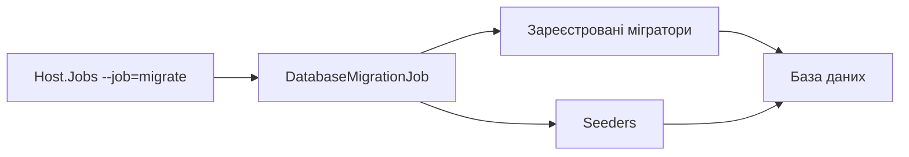

# Міграції та seed

**Статична звірка з кодом:** 2026-10-16. **Модуль:** platform.

Окрема job, що змінює схему і початкові дані.

## Будова й зв'язки

[Host.Jobs](../../../../src/Bootstrapper/Host.Jobs/Host.Jobs/Program.cs) обирає `--job=migrate`; [DatabaseMigrationJob](../../../../src/Bootstrapper/Host.Jobs/Host.Jobs/DatabaseMigrationJob.cs) виконує зареєстровані мігратори, потім seeders. [Host.Api](../../../../src/Bootstrapper/Host.Api/Program.cs) автоматично цей цикл не запускає. Перед job перевір конфігурацію і цільову БД.

## Структура в коді

Наведено перевірені точки входу та ключові складові фічі; дерево не перелічує всі допоміжні файли.

```text
src/
└── Bootstrapper/
    ├── Host.Api/Program.cs  # API-хост; міграції не запускає
    └── Host.Jobs/Host.Jobs/
        ├── DatabaseMigrationJob.cs  # запуск job
        └── Program.cs  # запуск job
```

## Схема будови



## Пов'язані джерела

[Процедура](../../operations/data/migrations-and-seeding.md) · [SDD](../../specs/platform/001-database-migration-job/README.md).
