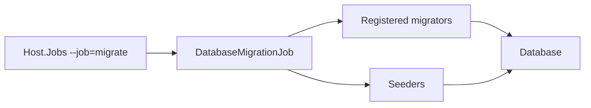

# Database migrations and seed data

**Static code check:** 2026-10-16. **Module:** Platform.

A separate job changes the schema and initial data.

## Structure and relationships

[Host.Jobs](../../../../src/Bootstrapper/Host.Jobs/Host.Jobs/Program.cs) selects `--job=migrate`; [DatabaseMigrationJob](../../../../src/Bootstrapper/Host.Jobs/Host.Jobs/DatabaseMigrationJob.cs) runs registered migrators, followed by seeders. [Host.Api](../../../../src/Bootstrapper/Host.Api/Program.cs) does not run this process automatically. Check configuration and the target database before running the job.

## Code structure

The tree lists verified entry points and key components, not every supporting file.

```text
src/
└── Bootstrapper/
    ├── Host.Api/Program.cs  # API host; does not run migrations
    └── Host.Jobs/Host.Jobs/
        ├── DatabaseMigrationJob.cs  # runs the job
        └── Program.cs  # runs the job
```

## Structure diagram



## Tests

[DatabaseMigrationJobTests.cs](../../../../tests/IntegrationTests/Platform/Jobs/DatabaseMigrationJobTests.cs) · [IdentityMigrationLineageTests.cs](../../../../tests/IntegrationTests/Identity/Persistence/IdentityMigrationLineageTests.cs)

Focused run: `dotnet test tests/IntegrationTests/IntegrationTests.csproj --filter "FullyQualifiedName~Migration"`.

## Related sources

[Procedure](../../operations/data/migrations-and-seeding.md) · [SDD](../../specs/platform/001-database-migration-job/README.md).
